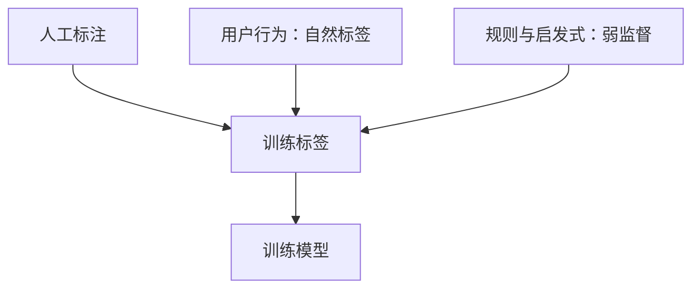

## Q
训练数据的标签（label）有哪三种主要来源？各自的成本、质量和典型场景是什么？

## A
**标签**：训练时告诉模型的"正确答案"，例如"这条评论是垃圾"或"用户看完了这个视频"。模型（从数据里学出来的函数）只能学到标签里有的东西。

- **人工标注**（human labeling）：请标注员按标注指南逐条判断。
  - 质量最高，可控；但贵、慢。一条文本判断 10–30 秒，一条医学图像可能要专家几分钟。
  - 适合：内容审核、医疗、需要专业判断的任务，以及建立评测集。
- **自然标签 / 隐式反馈**（natural labels，implicit feedback）：用户的行为本身就是答案。推荐里"点了、看完了"，搜索里"点了第几条"，输入法里"接受了补全"。
  - 量极大、几乎免费、天然跟着线上分布走；但有噪声（误点）、有偏差（只对展示过的东西有反馈）、有延迟。
  - 适合：推荐、搜索、广告、补全。
- **弱监督**（weak supervision）：用规则、关键词、已有系统的输出或另一个模型自动打标签，数量多但单条不一定准，再用统计方法合并多条规则的意见。
  - 便宜、快；但准确率有限，规则的盲区会变成模型的盲区。
  - 适合：冷启动阶段、标注预算少的场景。

**实际系统通常混用**：用自然标签或弱监督得到大量训练数据；用少量高质量人工标注做验证集和测试集。评测用的标签必须是最准的那一种，否则你在用噪声衡量模型。
