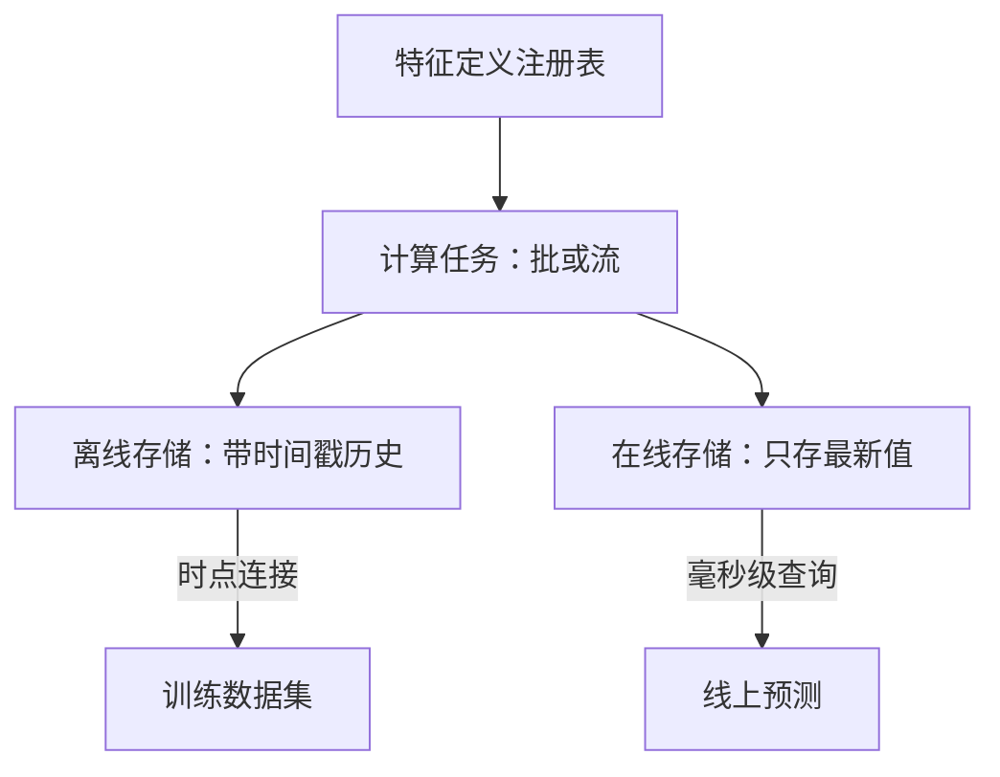

## Q
特征存储（feature store）由哪几部分组成？训练和线上预测分别怎样从它取特征？以 Feast 为例写出调用。

## A
**特征存储**：集中定义、计算、存放和提供特征的系统，目标是同一个特征只定义一次，训练和线上用到的值保持一致。



- **注册表**（registry）：特征的名字、实体（按用户还是按视频）、类型、计算逻辑、负责人、新鲜度要求。
- **离线存储**：数据仓库或对象存储里的完整历史，每个值带时间戳，用于生成训练集。
- **在线存储**：Redis、DynamoDB 这类键值存储，每个实体只存最新值，毫秒级读。
- **物化**（materialize）：把离线计算好的最新值写进在线存储；流式特征直接写在线存储并回写离线存储。

**Feast 里的两条路径：**
```python
from feast import FeatureStore
store = FeatureStore(repo_path=".")
# 训练：对每条样本按它的时间戳做时点连接
train_df = store.get_historical_features(
    entity_df=impressions,   # 列：user_id, video_id, event_timestamp, label
    features=["user_stats:watch_7d", "video_stats:ctr_24h"],
).to_df()
# 线上：取最新值
online = store.get_online_features(
    features=["user_stats:watch_7d", "video_stats:ctr_24h"],
    entity_rows=[{"user_id": 42, "video_id": 7}],
).to_dict()
```
`feast materialize-incremental <结束时间>` 把新数据同步到在线存储。

**它解决了什么**：计算逻辑只有一份；训练用的是样本发生那一刻的值，不会泄漏未来；团队之间可以复用特征。**没解决什么**：请求时才知道的特征（当前页面、搜索词）仍然要在服务里算，那部分要靠共享代码库保证一致。
