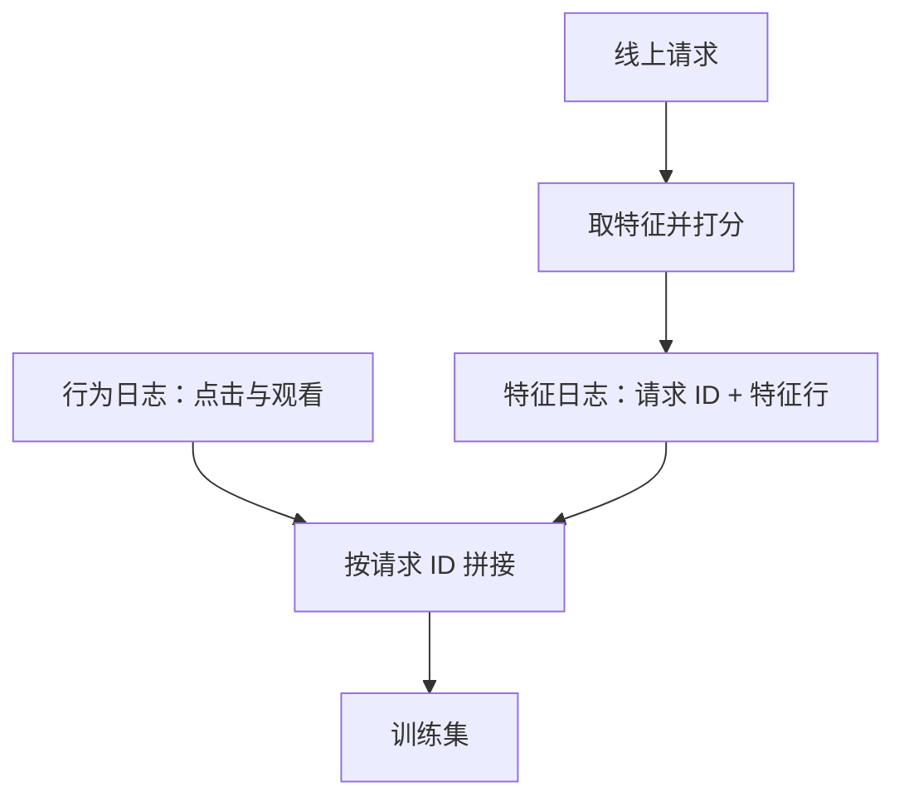

## Q
保证训练和线上特征一致有两条路：用特征存储做时点回填，或者把线上特征直接记进日志再拿来训练。两者怎么比较？

## A
**做法一：时点回填**（point-in-time backfill）。特征存储保存每个特征带时间戳的历史，生成训练集时对每条样本取"样本时刻之前最近的值"。

**做法二：记录再训练**（log-and-train）。线上服务在做预测时，把实际喂给模型的整行特征和请求 ID 写进日志；之后再把标签（点击、观看）按请求 ID join 上来，作为训练数据。业界常说"最好的'像服务一样训练'的方法，就是保存服务时用的特征"。

**比较：**
- **一致性**：记录再训练是"所见即所训"，连线上的 bug 和延迟都原样记录，一致性最好；回填依赖离线逻辑和线上逻辑真的相同。
- **新特征**：回填可以给历史样本补算一个新特征，当天就能训练评估；记录再训练要先把新特征上线记录，等攒够几周日志才能训练。
- **存储**：记录每次曝光的全部特征很贵（每天 100 亿行 × 1 KB ≈ 10 TB），通常只记录被采样的那部分；回填只存特征历史，便宜得多。
- **未被打分的候选**：日志里只有线上打过分的候选；离线想评估一个新召回策略召回的其他视频，只有回填能补出它们的特征。

**常见组合**：主力模型用记录的特征训练，保证一致；开发新特征时先用回填做实验，效果确认后再上线记录，切换到日志训练。两套并存时，定期抽样比对同一请求的日志特征和回填特征，差异率作为一致性指标监控。
