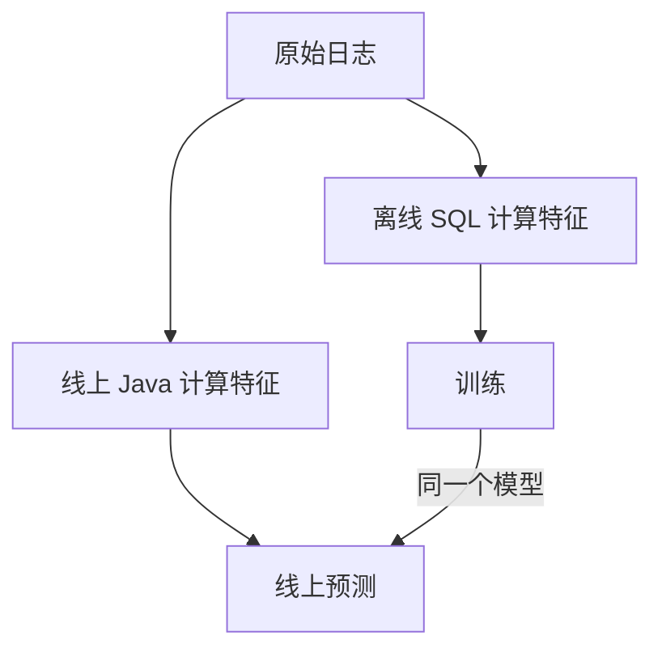

## Q
什么是训练与服务偏差（training-serving skew）？它有哪几种成因？举一个具体例子。

## A
**定义**：模型在线上做预测时看到的输入，和训练时看到的输入不一样，导致线上效果明显比离线评估差。模型本身没有问题，问题在数据。

**成因一：两份代码。** 离线用 SQL 或 Spark 算特征，线上为了延迟用另一种语言重写。两份实现在边界上不一致：
- 离线"过去 7 天"按 UTC 自然日算，线上按滚动 168 小时算；
- 离线把空值填 0，线上填 −1；
- 离线对文本先转小写，线上忘了。

**成因二：数据的时间不同。** 训练时 join 的是今天的特征表，线上用的是请求那一刻的值（时点不一致）。或者线上的流处理特征有 10 分钟延迟，训练时却用了准时的值。

**成因三：分布本身在变化。** 训练数据来自上个月，线上已经出现了新用户群、新类型的内容。严格说这叫数据漂移，但现象相同。

**具体例子**：排序模型的特征"用户过去 7 天观看时长"，离线单位是秒，线上服务的工程师读的是另一张以分钟为单位的表。线上这个特征比训练时小 60 倍，模型认为所有用户都是轻度用户，推荐全偏向短视频；没有任何报错，观看时长下降 4%。

**根治方向**：特征只定义一次、离线和线上共用同一份代码（特征存储）；或者把线上实际用到的特征值记进日志，训练直接用日志。
