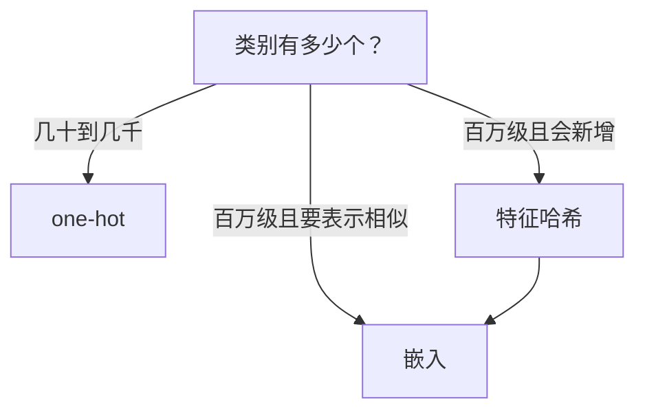

## Q
类别特征（城市、视频 ID、用户 ID）怎么变成模型能用的数字？one-hot、特征哈希和嵌入各怎么做、怎么选？

## A
**类别特征**：取值是有限个"名字"的字段，名字之间没有大小关系。把"北京 = 1、上海 = 2"直接喂给模型是错的，模型会以为上海比北京"大一倍"。

- **one-hot 编码**：有 N 个类别就用 N 维向量，对应那一维为 1，其余为 0。
  - 适合：类别少且固定（设备类型 5 种、国家 200 个）。
  - 问题：100 万个视频 ID 就是 100 万维；新出现的类别没有位置。
- **特征哈希**（hashing trick）：`桶号 = hash(值) mod B`，直接用桶号做 one-hot，B 固定（例如 2^20 ≈ 100 万）。
  - 优点：不用维护词表，新类别自动有位置，内存固定。
  - 代价：碰撞，不同的值落进同一个桶。100 万个值放进 100 万个桶，按均匀哈希估算约 37% 的桶是空的，很多桶里挤了两个以上的值。热门值被冷门值污染一点通常可以接受。
- **嵌入**（embedding）：为每个类别学一个短向量（例如 32 维），作为模型参数一起训练；相似的视频训练后向量会接近。
  - 优点：维度小、能表达相似性，是推荐系统里 ID 类特征的标准做法。
  - 维度经验：常见起点是类别数的四次方根，100 万类约 32 维；再按效果调。
  - 代价：参数量 = 类别数 × 维度，100 万 × 32 × 4 字节 ≈ 128 MB；冷门类别训练不充分。

**组合用法**：先哈希到固定数量的桶，再给每个桶学一个嵌入，既控制内存又能处理新值。出现次数太少的类别（例如少于 5 次）统一映射成"其他"。
