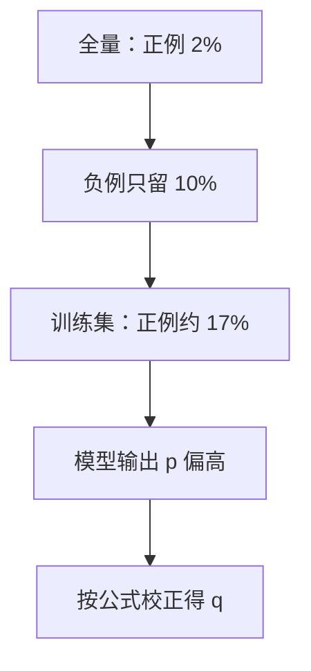

## Q
点击率预测里常把负例下采样（negative downsampling）到 10%。为什么这样做之后模型输出的概率会偏高？怎么修正？手算一个例子。

## A
**为什么下采样**：曝光里 98% 没被点击（负例），全量训练又贵又被负例淹没。只保留 10% 的负例、全部正例，训练数据少了约 90%，模型效果通常几乎不变。

**副作用**：训练集里正例的比例被人为抬高了约 10 倍，模型学到的"点击概率"也跟着偏高。如果下游拿这个概率去算广告出价、预计收入或报警阈值，就会全部算错。只用来排序时不受影响，因为偏高对所有候选是同方向的。

**修正公式**：设负例保留比例为 w（这里 0.1），模型输出 p，校正后的真实概率
q = p ÷ (p + (1 − p) ÷ w)

**手算**：模型输出 p = 0.5。
q = 0.5 ÷ (0.5 + 0.5 ÷ 0.1) = 0.5 ÷ (0.5 + 5) = 0.5 ÷ 5.5 ≈ **0.091**。

**直觉**：每个被丢掉的负例都"代表"了 1/w = 10 个负例，把负例那部分乘回 10 倍就得到真实比例。

**怎么验证校正对了**：在**未下采样**的真实流量上，把预测概率分成 10 段，每段比较平均预测值和实际点击率（可靠性图，reliability diagram）。校正正确时两者接近一条对角线；整体上"预测点击总数 ÷ 实际点击总数"应接近 1。

**替代做法**：不改数据，给负例样本权重 1/w 训练，结果期望上一致；或训练完再拟合一个单独的校准函数（例如保序回归，isotonic regression）。
