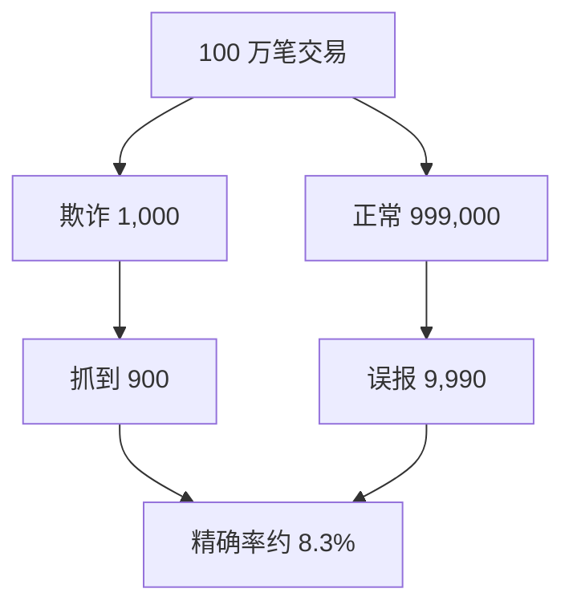

## Q
一个欺诈模型在"正负各半"的测试集上精确率 98.9%，上线后报警里大部分都是误报。为什么？用数字算出来。

## A
**原因**：测试集被重新平衡过，正例比例从真实的 0.1% 变成了 50%。召回率（真欺诈里被抓到的比例）和误报率（正常交易里被误报的比例）不受比例影响，但**精确率**（报警里真是欺诈的比例）强烈依赖正例比例。

**设模型召回率 90%、误报率 1%。**

**平衡测试集**：1,000 个正例、1,000 个负例。
- 真阳性 = 1,000 × 0.9 = 900
- 假阳性 = 1,000 × 0.01 = 10
- 精确率 = 900 ÷ 910 ≈ **98.9%**

**真实流量**：100 万笔交易，0.1% 是欺诈，即 1,000 笔欺诈、999,000 笔正常。
- 真阳性 = 900
- 假阳性 = 999,000 × 0.01 = 9,990
- 精确率 = 900 ÷ 10,890 ≈ **8.3%**

同一个模型，换个测试分布，精确率从 98.9% 掉到 8.3%：每 12 次报警只有 1 次是真的，人工复核团队会被淹没。

**正确做法：**
- 训练可以用采样后的数据，**测试集必须保持真实比例**（或按真实比例给指标加权）。
- 报告在真实比例下的精确率和每天的报警量（这里每天每 100 万笔约 1.09 万次报警），和复核团队的处理能力对比。
- 想把误报压下来，要提高阈值，或者把误报率从 1% 降到 0.1% 以下。在正例极少的场景，误报率的一个零头就决定了精确率。
