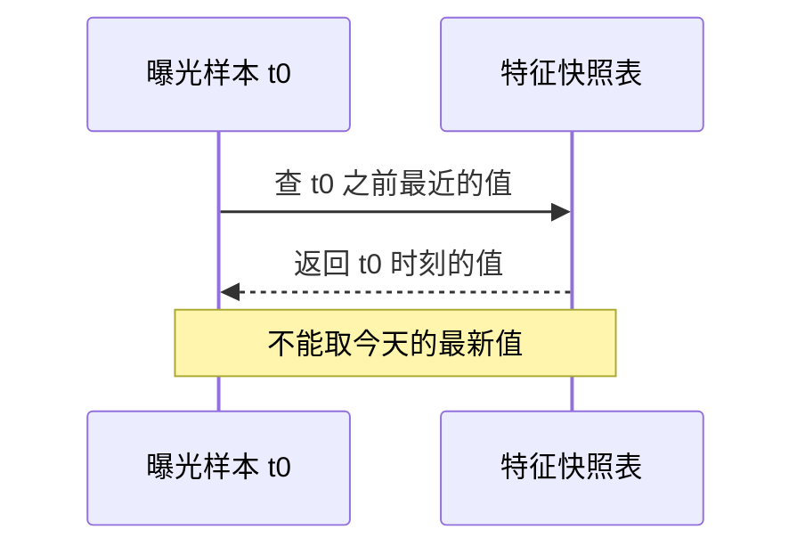

## Q
什么是特征的"时点正确性"（point-in-time correctness）？举一个特征把未来信息带进训练的例子，以及正确的做法。

## A
**时点正确**：训练样本里每个特征的值，必须是**在那次预测发生的时刻**能拿到的值，不能包含之后才产生的信息。

**泄漏例子**：预测"用户会不会点开这个视频"。特征"该视频累计播放数"是从**今天**的视频统计表里 join 出来的。
- 一个月前的曝光样本，用的却是今天的播放数 500 万；而曝光那一刻它只有 2 千。
- 后来爆火的视频今天播放数都很高，模型学到"播放数高 = 会点"，离线 AUC 很高。
- 上线后，新视频的播放数都很小，这条规律派不上用场，效果下降。

**同类错误**：
- 用户画像表每天覆盖写，训练时 join 的是最新画像，例如"会员等级"在样本发生之后才升级。
- 计算"过去 7 天点击率"时窗口的右端用了样本日期当天的全天数据，包含了曝光之后的点击。

**正确做法：**
- 特征表保存**带时间戳的历史版本**，而不是只存最新值。
- 训练时做"时点连接"（point-in-time join，也叫 as-of join）：对每条样本，取时间戳 ≤ 样本时间的最近一条特征值。特征存储（如 Feast 的 `get_historical_features`）就是做这件事的。
- 更彻底的办法：把线上预测时实际用到的特征值写进日志，训练直接用日志里的值，天然时点正确。

**发现手段**：某个特征重要性异常高时，检查它的取值时间是否晚于样本时间。
