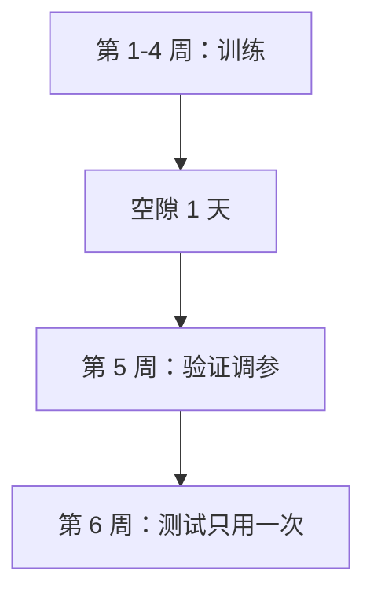

## Q
用户行为数据为什么要"按时间切分"训练集和测试集，而不是随机切？具体怎么切，为什么中间要留一段空隙？

## A
**随机切的问题**：把 6 周的日志随机打散成 80% 训练、20% 测试，测试集里第 2 周的样本，训练集里有第 3–6 周的样本。模型等于"看过未来"：它从第 5 周的数据知道哪些视频后来火了，再去"预测"第 2 周，分数自然虚高。上线后只能用过去预测未来，分数就掉下来。

**按时间切**：模仿上线后的真实情况，永远用过去训练、用未来评估。

- **训练集**：第 1–4 周。
- **验证集**（用来调超参数、选模型的数据）：第 5 周。
- **测试集**：第 6 周，所有决定做完后只用一次。

**为什么留空隙**（gap）：标签有延迟。如果标签定义是"曝光后 24 小时内看过一半"，第 4 周最后一天的曝光，标签要到第 5 周第一天才确定；用于计算这些标签的观看行为和第 5 周开头的样本重叠。留出至少一个标签窗口的空隙，训练集就不会碰到验证期的信息。风控里标签窗口是几十天，空隙也要几十天。

**滚动回测**（backtesting）：只切一次，结果受那一周的特殊情况影响（节假日、热点事件）。更稳的做法是滚动多次：用第 1–4 周训练测第 5 周，用第 2–5 周训练测第 6 周……取平均并看波动。

**代价**：测试集分布和训练集不同，分数比随机切低。这不是坏事，它是对上线效果更诚实的估计。
