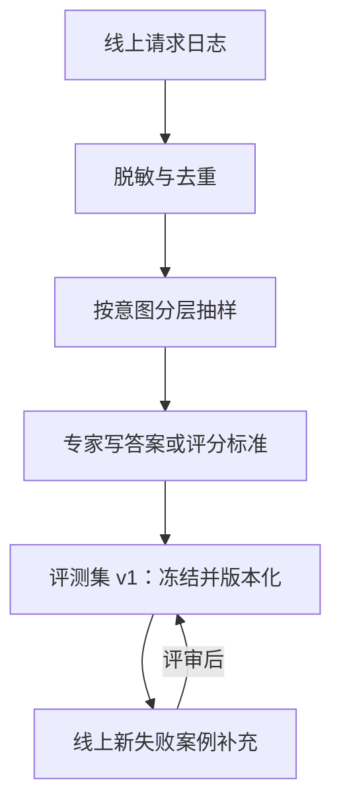

## Q
怎样为一个大模型应用建立自己的业务评测集？要多少题、怎么分层、怎么维护，才能用来做发布决策？

## A
**为什么要自己的评测集**：公开基准测的是通用能力，可能已被训练数据污染，也覆盖不到你的产品。发布决策要看"在我的用户问题上好不好"。

**建设步骤：**
- **从真实请求抽样**：抽线上日志，去掉个人信息，去重。
- **分层**：按意图或场景分类（退货、物流、账号、闲聊、越权请求……），每层保证最少题数；高风险类别（安全、金融、医疗）按比例多抽。
- **答案或评分标准**：有唯一答案的写标准答案，程序判断；开放式的写评分要点，供人工或评委打分。
- **加入困难样本**：历史上出过错的案例、对抗性提问、超长输入、多语言输入。

**要多少题**：看你想检测多大的变化。准确率在 80% 左右时，单次测量的标准误 = √(0.8 × 0.2 ÷ n)：
- n = 400：约 2 个百分点，只能看出 4–5 个点以上的差异；
- n = 2,000：约 0.9 个百分点。
- 每个切片也要有足够的题，一个只有 30 题的切片，差几道题就是十几个点，不能单独作为阻断依据。

**维护：**
- **冻结与版本化**：评测集一旦用于发布判定就冻结，改动发新版本；不同版本的分数不直接比较。
- **持续补充**：线上发现的新失败案例经评审后加入下一版，评测集随产品长大。
- **防止过拟合**：分出一份日常调试用的开发集和一份只在发布前使用的保留集。
- **防止污染**：评测题不得进入任何微调数据，入库时自动去重检查。
