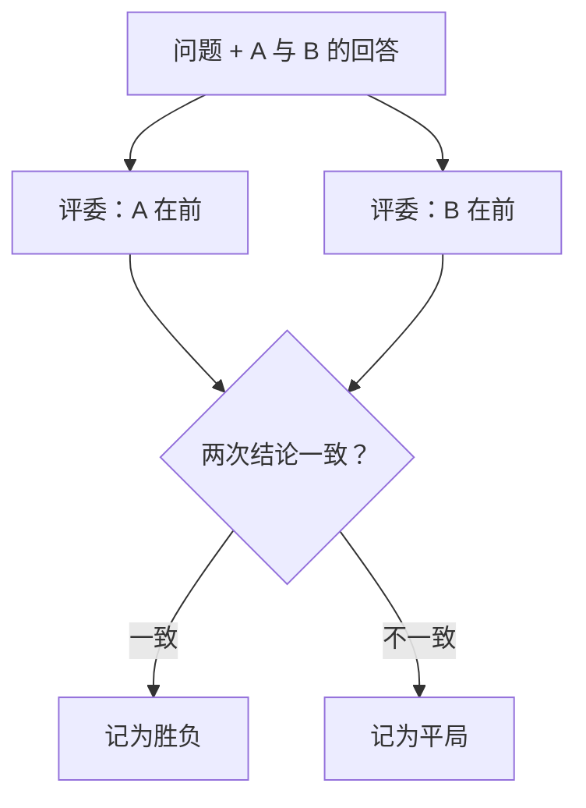

## Q
用"大模型当评委"（LLM-as-a-judge）评测时，逐条打分和成对比较各怎么做？评委有哪些偏差，怎样减轻？

## A
**两种用法：**
- **逐条打分**（pointwise）：给评委一份评分标准、问题和一个回答，让它打 1–10 分并说明理由。简单，可以评单个模型；但分数漂移大，不同批次的 7 分不一定等价。
- **成对比较**（pairwise）：给评委同一个问题和两个模型的回答，让它选更好的一个或判平局。更稳定，和"新版本比旧版本好吗"这个发布问题直接对应。

**已知的偏差：**
- **位置偏差**：倾向于选先出现（或后出现）的那个回答。
- **长度偏差**：倾向于更长、更详细的回答，即使多出来的内容没用。
- **自我偏好**：倾向于和自己风格相近、甚至是自己生成的回答。
- **能力上限**：评委自己不会的数学题或专业问题，也判断不了谁对。

**减轻办法：**
- **交换顺序评两次**：两次结论一致才算胜负，否则算平局，直接消掉位置偏差。
- **写清评分标准**：列出要看的要点（事实正确、遵循指令、简洁），并要求"长度本身不加分"。
- **参考答案**：有标准答案时提供给评委，让它对照判断，而不是凭自己的知识。
- **评委和被评模型不同源**：避免自我偏好。
- **用人工标注校准**：先请人标几百条，计算评委和人的一致率。公开研究里，强模型当评委和人类的一致率可以超过 80%，和人与人之间的一致率相当；你的任务上要自己测，达标才用。
- **固定评委版本**：评委模型换了，分数就不可比；评委本身的版本要和评测集一起锁定。
