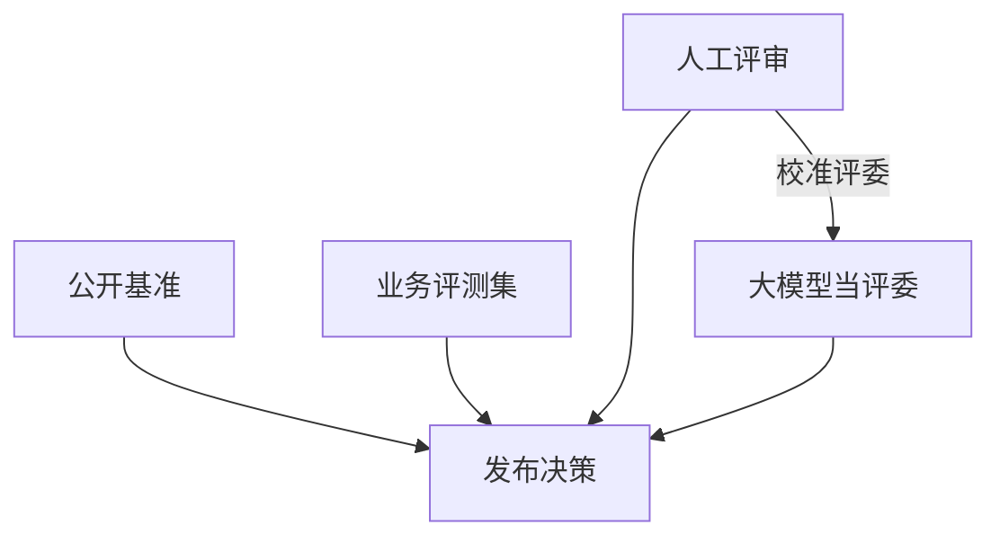

## Q
评测一个大语言模型有哪几类方法？公开基准、业务评测集、人工评审和"大模型当评委"各回答什么问题、各有什么局限？

## A
**为什么难**：大语言模型（LLM，根据一段文字逐个预测下一个词、从而生成回答的大型神经网络）的输出是开放的文字，同一个问题有很多种正确答法，不能简单地"和标准答案逐字比较"。

- **公开基准**（benchmark）：大家都用的固定题集，例如多学科选择题、小学数学应用题、带单元测试的编程题。
  - 回答：通用能力大概在什么水平，和别的模型比如何；推理引擎改动后数值有没有变。
  - 局限：题目公开，可能已被爬进训练数据（污染）；和你的业务关系有限；分数受提示格式影响很大。
- **业务评测集**：从自己的真实请求里抽题，配上标准答案或评分标准。
  - 回答：在我的产品上好不好。这是最重要的一类。
  - 局限：要花人力建设和维护；题量小时统计噪声大。
- **人工评审**：请人按评分标准打分，或者看两个模型的回答选更好的一个（成对比较）。
  - 回答：质量、语气、有用性这些程序判断不了的维度。
  - 局限：贵、慢（一条几十秒到几分钟），评审员之间也不一致。
- **大模型当评委**（LLM-as-a-judge）：让一个强模型按评分标准给回答打分或二选一。
  - 回答：用接近人工的方式大规模、便宜地评开放式回答。
  - 局限：有系统性偏差（偏爱第一个出现的、偏爱长的、偏爱自己风格的），必须用人工标注校准。

**能程序判断的先程序判断**：答案是数字就比数字，要求 JSON 就解析 JSON，代码就跑测试。评委和人工只用在程序判断不了的地方。
