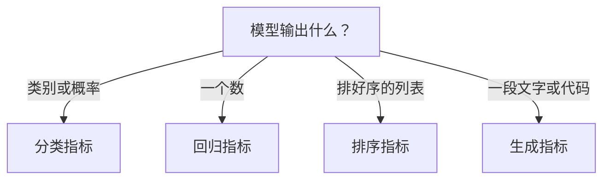

## Q
离线评估时，分类、回归、排序、生成四类任务各用什么指标？各用一句话说清每个指标衡量什么。

## A
**离线评估**：用已有的历史数据（带标签，即正确答案）给模型打分，不碰真实用户。先按任务类型选指标：

- **分类**：精确率（报为阳性的里面真阳性的比例）、召回率（真阳性里被报出来的比例）、F1、ROC-AUC 与 PR-AUC（不依赖阈值的排序能力）；需要概率本身准确时再看**对数损失**（log loss）和**校准**（预测 0.3 的样本里是否真有约 30% 是阳性）。
- **回归**：MAE（平均绝对误差，预测和真实差多少的平均）对极端值不敏感；RMSE（均方根误差）对大误差惩罚更重；分布很偏时（观看时长、价格）常在对数尺度上算。
- **排序 / 推荐 / 搜索**：
  - Precision@k：前 k 个结果里相关的比例；
  - Recall@k：所有相关结果中进入前 k 的比例，常用来评召回阶段（例如 Recall@500）；
  - MRR（平均倒数排名）：第一个相关结果排在第 r 位就得 1/r，适合"只要一个正确答案"的场景；
  - NDCG@k：考虑相关程度和位置，越相关的越靠前分数越高，最常用。
- **生成**：
  - 困惑度（perplexity，模型对一段真实文本"有多意外"，越低越好），只能在同一个分词器的模型之间比较；
  - BLEU、ROUGE：和参考答案的词语重叠程度，用于翻译和摘要；
  - pass@k：代码生成里，k 次尝试中至少一次通过单元测试的概率；
  - 开放式回答：靠人工评审或另一个模型当评委。

**选指标的两条规则**：指标要和产品怎么用模型输出一致（只展示前 10 条，就看 @10）；再选一个和业务指标最相关的作为主指标，其余作为诊断。
