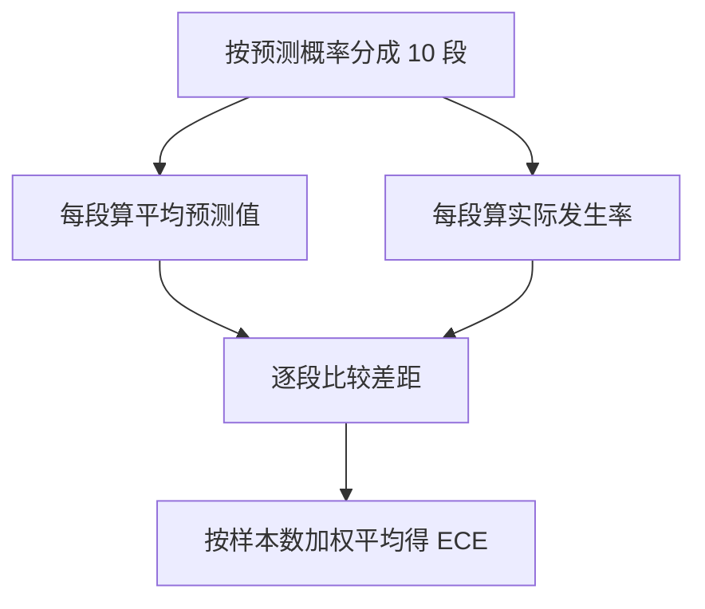

## Q
什么是概率校准（calibration）？为什么 AUC 很高的模型也可能校准很差？怎样用 ECE 衡量，手算一个例子。

## A
**校准**：模型说"30% 的可能"，在所有它这么说的样本里，实际就有约 30% 发生。校准好的模型，概率可以直接拿来做决策：广告出价 = 点击概率 × 每次点击价值，预计报警量 = Σ 概率。

**AUC 高 ≠ 校准好**：AUC 只看排序（正例是否排在负例前面）。把所有预测值都除以 2，排序不变、AUC 不变，但概率全部偏低一半。负例下采样、损失加权、模型过度自信都会造成这种情况。

**ECE**（期望校准误差）：分段比较"平均预测概率"和"实际发生率"，按每段样本占比加权求平均差距。

**手算**（简化为 3 段，共 1,000 个样本）：
| 段 | 样本数 | 平均预测 | 实际发生率 | 差距 |
|---|---|---|---|---|
| 低 | 600 | 0.05 | 0.04 | 0.01 |
| 中 | 300 | 0.30 | 0.20 | 0.10 |
| 高 | 100 | 0.80 | 0.60 | 0.20 |

ECE = 0.6 × 0.01 + 0.3 × 0.10 + 0.1 × 0.20 = 0.006 + 0.030 + 0.020 = **0.056**。模型整体过度自信，高分段最严重。

**还要看的两个数：**
- **对数损失**（log loss）：同时惩罚排序错和概率不准，是概率质量的综合指标。
- **预测总和 ÷ 实际总和**：广告系统常盯这个比值，应接近 1.0；偏离 5% 就会直接影响收入预估。

**修正**：在留出的验证集上拟合一个校准函数，例如 Platt 缩放（对模型分数再做一次逻辑回归）或保序回归（isotonic regression，学一个单调的分段映射）。下采样造成的偏差也可以直接用公式校正。
