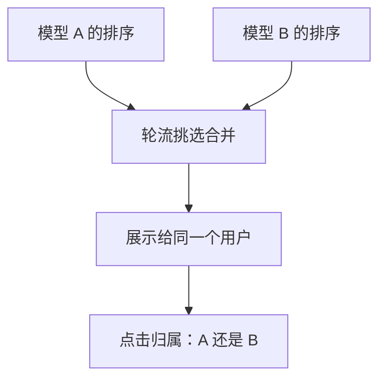

## Q
除了经典 A/B 实验，还有交错实验（interleaving）、多臂老虎机（bandit）和按集群或时间片分组的实验。它们各解决 A/B 的什么问题？

## A
**交错实验**（interleaving）：用于比较两个排序模型。不是把用户分两组，而是给**同一个用户**展示一个由两个模型的结果交替合并而成的列表，看用户点的结果更多来自哪个模型。
- 常用"团队选人"法：像两队队长轮流挑人，A、B 轮流把自己排名最高、还没入选的结果放进列表，记住每条属于谁。
- 优点：同一个用户同时比较两者，消除了用户之间的差异，通常只需 A/B 的一小部分流量就能分出高下，适合快速筛掉大量候选模型。
- 局限：只说明哪个排序更受欢迎，测不了留存、时长这类整体业务指标，最终仍要 A/B 确认。

**多臂老虎机**（multi-armed bandit）：一边实验一边把更多流量分给表现好的版本，减少把用户长期留在差版本上的损失。
- 适合：生命周期短、只关心快速选优的场景，例如新闻标题、促销文案。
- 局限：流量比例一直在变，不适合做严谨的因果估计，也不适合长期指标。

**集群分组与时间片轮换**：当用户之间相互影响时（社交网络、网约车、外卖派单），按用户随机会互相污染。
- **集群随机**：按城市或社交圈整体分组，一个圈子里的人全部用同一版本。
- **时间片轮换**（switchback）：同一个城市每隔一段时间（例如 1 小时）在新旧版本之间切换，比较不同时间片。
- 代价：实验单位变少，需要更长时间才能显著。

**影子部署和金丝雀不是效果实验**：影子部署只算不返回，看输出分布和延迟；金丝雀用 1% 流量看错误率。它们回答"能不能安全上线"，A/B 回答"上线后是不是更好"。
