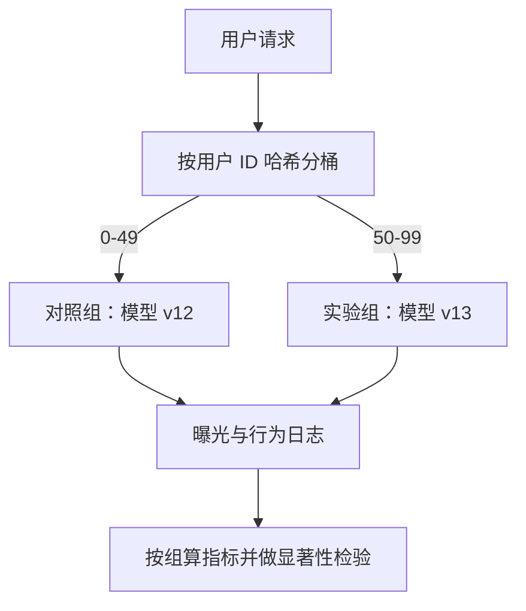

## Q
一个线上 A/B 实验是怎么运转的？用户怎样被稳定地分到实验组，主指标和护栏指标分别是什么？

## A
**A/B 实验**：把真实用户随机分成两组，对照组（A）用旧模型，实验组（B）用新模型，其余一切相同；比较两组的指标，差异就归因于模型。随机分组保证两组用户在其他方面平均一样。



**稳定分组**：
```python
import hashlib
def bucket(user_id: str, experiment: str) -> int:
    h = hashlib.sha256(f"{experiment}:{user_id}".encode()).hexdigest()
    return int(h[:8], 16) % 100
```
- 同一用户每次请求都落在同一组，体验一致，也能看长期行为。
- 哈希里带上实验名，不同实验的分组相互独立，避免"每次都是同一批人当实验组"。
- 按用户而不是按请求分：按请求分时同一个人两种推荐交替出现，指标互相污染。

**指标分三类：**
- **主指标**（primary）：决定是否发布的一个指标，例如人均日观看时长。事先定好，只定一个。
- **护栏指标**（guardrail）：不许明显变差的指标：7 日留存、举报率、退订率、p99 延迟、错误率、收入。主指标涨了，护栏跌了也不能发布。
- **诊断指标**：点击率、完播率、各类内容占比，用来解释为什么涨或跌。

**流程**：事先写好假设、主指标、最小可检测效果、样本量和运行时长；跑满预定时间（至少覆盖一个完整的星期周期）；再做显著性检验并看各切片；最后决定发布、迭代或放弃。
