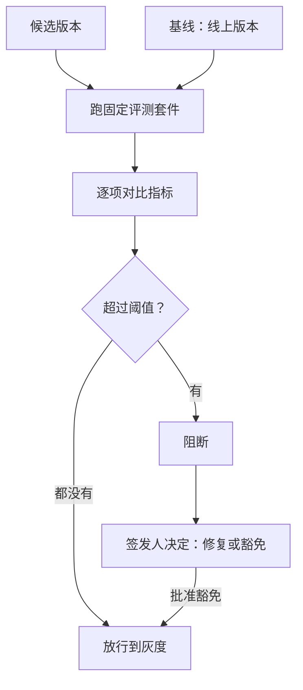

## Q
模型上线前的回归门（regression gate）是怎么工作的？画出一个候选版本从评测到放行或阻断的流程。

## A
**回归门**：每个候选版本（新模型、新推理引擎、新量化方式）上线前，都自动跑**同一套**固定的评测，和当前线上版本（基线）比较；任何一项退化超过事先定好的阈值就阻断，不靠人临时判断。和软件的回归测试是同一个思路，只是断言换成了统计阈值。

**组成部分：**
- **评测套件**：质量（业务评测集、基准）、数值一致性（固定输入上的 logprob 与基线的差）、安全、性能（延迟、吞吐）。每项有版本号。
- **基线**：当前线上版本，在**同一环境、同一时间**重跑，而不是用几个月前存下的分数，排除环境差异。
- **阈值**：每项两条线：绝对下限（准确率不得低于 78%）和相对退化上限（比基线低不超过 1 个点）；关键切片单独设线。
- **判定**：全部通过自动放行；任一超线就阻断，生成一份对比报告，列出退化的指标、切片和逐题差异。
- **签发**：阻断后由负责人决定修复还是豁免，豁免要留记录。

**为什么要"门"而不是"看报告"**：发布压力下，人很容易对"只降了一点"放行。规则事先写好、自动执行，结论才不受截止日期影响；需要例外时走明确的豁免流程，留下谁、为什么、到什么时候。
