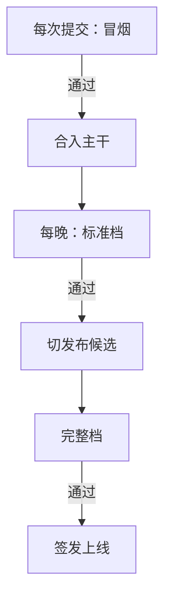

## Q
一个推理引擎或模型的回归门里应该放哪些评测？怎样分档，让每次提交、每晚和每次发布各跑合适的量？

## A
**四类评测，各抓一类问题：**
- **数值一致性**：固定输入上，和参考输出比较每个位置的 logprob（模型给每个输出词的对数概率）或 logits（模型对词表里每个词打的原始分数），差值在容差内。抓"算错了"：计算内核（kernel，GPU 上执行的底层函数）bug、量化（用更少比特存权重）误差超标。最快、最灵敏。
- **任务质量**：基准和业务评测集的准确率。抓"算得稍有不同、累积起来答错了"，以及模型本身变差。
- **安全**：有害请求拒答率、越狱通过率。
- **性能**：首个 token 延迟、每个输出 token 的间隔、吞吐、显存占用。抓"对了但变慢了"。

**分档：**
| 档 | 时机 | 内容 | 时长 |
|---|---|---|---|
| 冒烟 | 每次提交 | 50 条固定输入的 logprob 比对 + 加载与短生成 | 约 5 分钟 |
| 标准 | 每晚 | 数值比对 + 几个核心基准 + 业务评测集 | 1–2 小时 |
| 完整 | 发布候选 | 全部基准、全部业务切片、长上下文、安全、性能压测 | 数小时到一天 |

**为什么这样分**：数值比对几分钟就能发现大部分"算错"，适合放在最前面；准确率评测要生成大量文字，耗 GPU 小时，只能每晚或发布时跑；性能压测需要独占机器。

**覆盖矩阵**：引擎支持多种模型、精度、并行方式、硬件时，组合太多跑不完。冒烟档每个维度至少覆盖一次；完整档覆盖线上实际使用的组合，加上风险最高的新组合。

**每档的失败都要能定位**：保存每条输入的输出和差异，便于直接找到第一处出错的样本，再交给二分查找定位到具体提交。
