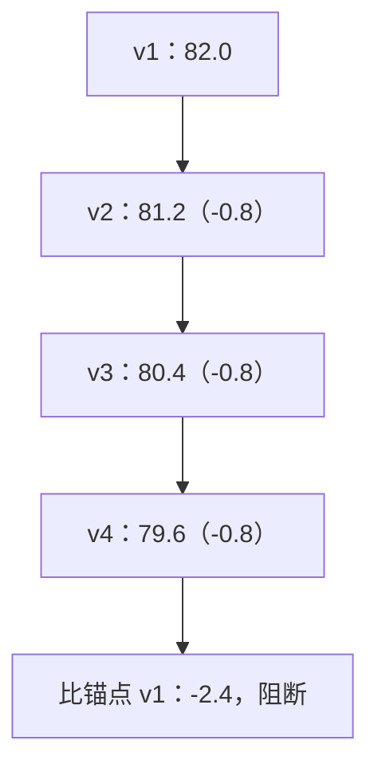

## Q
回归门阻断后，什么情况下可以豁免（waiver）？豁免要记录什么？基线每次都更新为上一版，会出现什么"温水煮青蛙"的问题，怎么防？

## A
**可以考虑豁免的情况：**
- 退化是**有意的取舍**：新的量化方式让准确率降 0.6 个点，但吞吐提高 40%，产品负责人认可。
- 退化在**已知不重要的切片**，且有修复计划和日期。
- 评测本身有问题：某道题的标准答案错了，新版本其实是对的（这时应修评测集，而不是豁免）。

**不能豁免的**：安全评测退化、数值一致性大幅超标（"静默算错"）、主指标显著下降且原因不明。

**豁免记录要写：**
- 哪个版本、哪项指标、退化多少、在哪些切片；
- 原因分析和为什么可以接受；
- 批准人（不能是提交改动的人自己）；
- 有效期和跟踪的修复事项；到期未修复自动重新阻断。

**温水煮青蛙**：如果每次都和"上一版"比，阈值是 1 个点，那么每一版降 0.8 个点都能通过，五个版本之后累计降了 4 个点，没有一次被阻断。

**防法：**
- **双基线**：同时和"上一版"以及一个**固定锚点**（例如上一个大版本或季度初的版本）比较；对锚点的累计退化另设阈值，例如 2 个点。
- **绝对下限**：关键指标设不可突破的绝对值。
- **趋势报表**：每个指标画出跨版本的曲线，连续几个版本同方向小幅下降就报警。
- **锚点更新要评审**：只有在确认新版本整体更好时，才把锚点前移，并记录原因。
