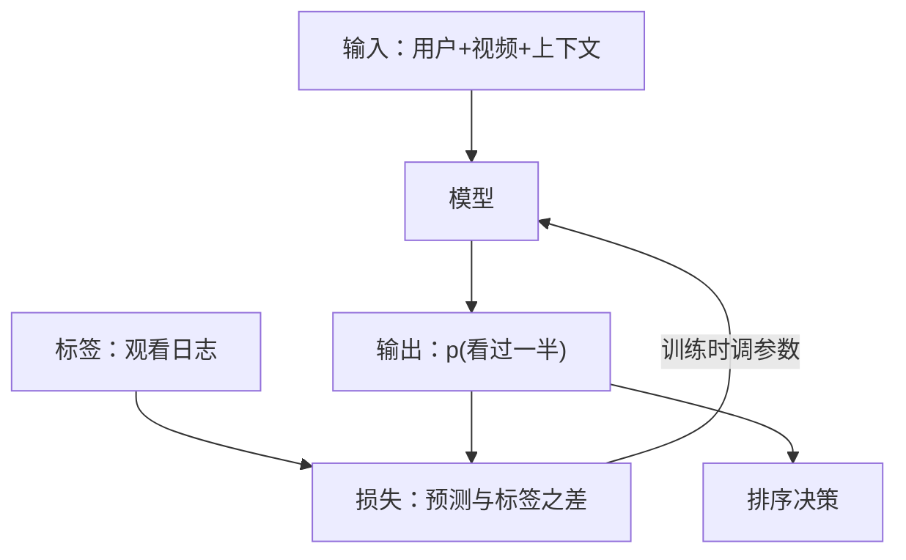

## Q
把一个业务问题"定义成 ML 任务"，具体要定下哪四样东西？以"给用户推荐视频"为例写出来。

## A
**ML 任务**：让模型（从历史数据学出来的函数）根据输入给出一个预测，再由系统根据预测做决策。定义它要定四样：

- **输入**：做一次预测时手里有什么。推荐里是（用户、一个候选视频、上下文如时段和设备）。必须是**预测那一刻真能拿到的**信息，"用户最终看了多久"就不能当输入。
- **输出**：模型吐出什么。可以是一个概率（用户看完一半以上的概率 0.37）、一个数（预计看 84 秒）、一个排好序的列表，或一段生成的文字。
- **标签**（label）：训练时这个输出的"正确答案"从哪来。推荐里来自观看日志：曝光后看过一半记 1，没点开记 0。标签拿不到，任务就定义不成立。
- **目标函数**（objective）：训练时要最小化的损失（loss，衡量预测离标签有多远的数），以及上线后真正关心的业务指标。例如训练时最小化交叉熵（分类常用的损失），业务上看日均观看时长。

**写在白板上：**
- 输入：user_id、video_id、用户近 50 次观看、视频类别与时长、时段、设备
- 输出：p(看过一半)、预计观看秒数
- 标签：曝光日志 join 观看日志，曝光后 24 小时内观看进度 ≥ 50% 为正
- 排序分 = p × 预计秒数；业务指标：人均日观看时长

**检查一遍**：输入在线上都能实时拿到吗？标签多久之后才知道（这里是 24 小时内）？输出能直接驱动决策吗（按分数排序即可）？三个答案都是"能"，定义才算完成。
