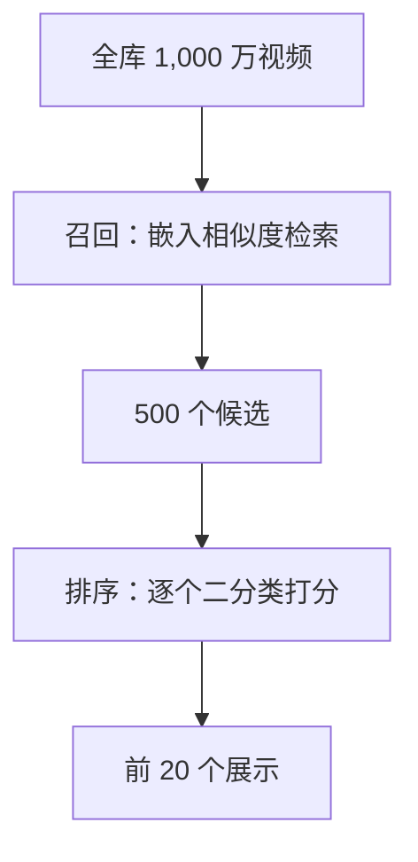

## Q
推荐系统的候选有 1,000 万个视频，为什么不能定义成"一个 1,000 万类的分类问题"直接输出该看哪个？输出空间的大小怎样影响任务定义？

## A
**直接做 1,000 万类分类会怎样**：模型最后一层要为每个类别输出一个分数，再用 softmax（把一组分数变成加起来等于 1 的概率）归一化。
- **算力**：最后一层是"隐藏向量 × 输出矩阵"。隐藏向量 256 维时，输出矩阵有 256 × 1,000 万 = **25.6 亿**个参数，每次请求要做约 25.6 亿次乘加，只为算一个分数表。
- **类别会变**：每天新增 10 万个视频，每加一个类就要改模型结构、重新训练。
- **训练信号稀疏**：绝大多数视频一年也只有几次正例。

**常用的改法：**
- **召回 + 排序**：先用嵌入（embedding，一串数字表示一个对象）做相似度检索，从 1,000 万里取 500 个；再把"用户 × 单个视频"定义成二分类，只对 500 个打分。新视频只要算出嵌入就能参与，无需改模型。
- **训练召回模型时采样**：softmax 只在"正例 + 几千个随机负例"上算，近似全量 softmax。

**输出空间的经验规则：**
- 几个到几百个固定类别（垃圾邮件、10 种违规类型）：直接多分类。
- 一个样本可以同时属于多个类（一条视频既暴力又含广告）：**多标签**（multi-label），每个类各用一个 sigmoid（把一个分数压到 0 到 1 之间）独立判断，不用 softmax。
- 候选上万且会变：转成检索 + 逐个打分。
- 输出是开放的文字：生成任务。

面试里说出"候选太多，所以把问题拆成检索加二分类"，就把任务定义和系统架构连起来了。
