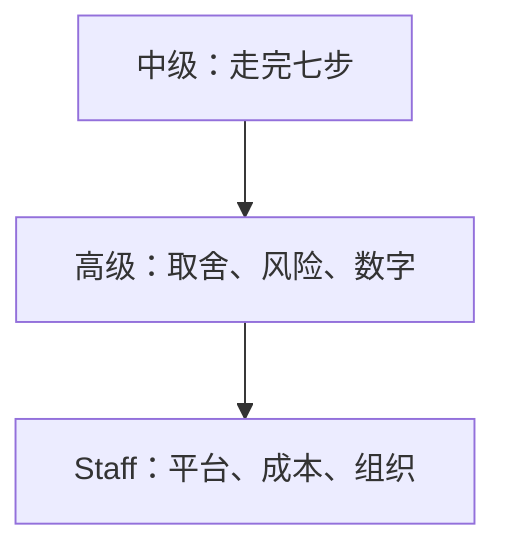

## Q
ML 系统设计面试对中级（mid）、高级（senior）、Staff 三个级别的期望分别是什么？

## A
**中级（mid-level）：能独立走完流程。**
- 七步（需求、ML 任务、数据、模型、评估、部署、监控）都覆盖到，不漏步。
- 每一步给出合理的标准做法：按时间切分数据、用 AUC 或 NDCG 评估、有个简单基线。
- 需要面试官提示才会讲深，例如被问到才想起冷启动。

**高级（senior）：讲清取舍和上线风险，自己主导节奏。**
- 每个选择都说出备选方案和放弃它的理由："批量预测更省，但新视频要等一天才能被推荐，所以召回用实时向量检索。"
- 主动讲失败模式：标签延迟、训练与服务特征不一致、反馈闭环、模型超时的降级。
- 用数字支撑判断：QPS、延迟预算、样本量、A/B 需要跑几天。
- 能就面试官挑的任何一处深挖下去。

**Staff：把单个系统放进组织和长期成本里看。**
- 讲平台而不只是一个模型：多个团队共用的特征存储、训练流水线、评测平台怎样避免重复建设。
- 讲成本与优先级：GPU 预算每月多少、哪部分优化投入产出比最高、什么时候不该用 ML。
- 讲演进路线：第一季度用规则加简单模型上线，半年后再上深度模型，一年后做多目标。
- 讲跨团队风险：上游数据团队改字段如何不弄坏你，下游谁在消费你的预测。
- 能识别并质疑题目本身的假设："这个场景先做好标注流程，比换模型收益更大。"

**简单判断**：中级回答"怎么做"，高级回答"为什么这样做、会坏在哪"，Staff 回答"值不值得做、组织怎样长期做好"。
