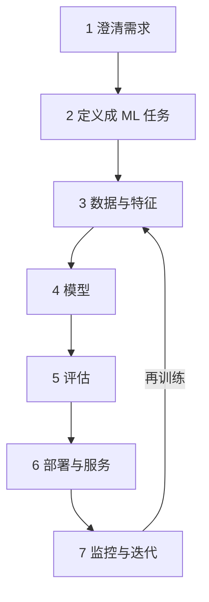

## Q
用"设计一个视频推荐系统"做例子，给出一份完整的 45 分钟 ML 系统设计答题模板：流程图、每步时间、每步说什么。

## A

- **0–5 分 需求**：目标是日均观看时长而非点击；日活 1 亿，峰值约 1.7 万 QPS；视频库 1,000 万；p99 ≤ 200 ms；有一年观看日志。
- **5–9 分 ML 任务**：输入（用户、候选视频、时段设备），输出"看完一半以上的概率"和"预计观看秒数"，两者加权成一个分数排序。标签直接取自观看日志。
- **9–16 分 数据**：一次曝光（视频出现在用户屏幕上）是一条样本；看过一半为正例，曝光没点为负例；按时间切分，前 4 周训练、第 5 周测试。特征：用户近期看过视频的平均嵌入（embedding，用一串数字表示一个对象，相似的对象数字接近）、视频类别与时长、时段、设备。
- **16–23 分 模型**：基线是热度排序。召回用双塔模型：用户塔、视频塔各输出一个嵌入，取最相似的 500 个；排序用一个同时预测点击和时长的多任务网络，只给这 500 个打分。
- **23–29 分 评估**：离线看召回率@500（真正被看的视频有多少进了这 500 个）和 NDCG@20（越该靠前的越靠前，分数越高）；在线 A/B，主指标观看时长，护栏是 7 日留存、举报率、p99 延迟。
- **29–36 分 部署**：视频嵌入每天离线算好，放进近似最近邻索引（快速找最相似向量、允许极少误差的检索结构）；请求时取特征 → 召回 → 排序 → 去掉已看和违规；排序 p99 50 ms，超时退回热门列表。
- **36–40 分 监控**：特征分布漂移、预测分数均值、点击率按小时报警；每天增量再训练；留 5% 流量随机探索，防止推荐只强化自己的历史。
- **40–45 分**：留给面试官深挖。
