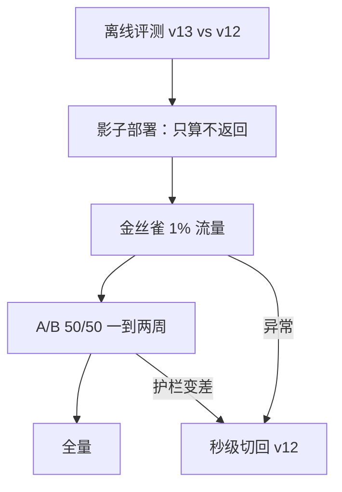

## Q
ML 系统的测试和发布，与普通服务相比有哪些不同？用"把排序模型从 v12 换成 v13"举例。

## A
**测试：从断言变成阈值。**
- 普通服务：`assert price(order) == 42`，确定的输入对应确定的输出。
- 模型：没有单个样本的"正确值"，只能说"在固定的 5 万条测试集上 AUC ≥ 0.80"（AUC：随机挑一个正例和一个负例，模型给正例打分更高的概率）。模型 v13 在某个样本上和 v12 给出不同结果，不一定是 bug。
- 还要测**数据**：输入字段的类型、取值范围、缺失比例；以及**行为**：把用户名换掉，垃圾评论分数不该变（不变性测试）。

**发布：要发的东西不只是代码。**
- 一次发布的单位是（模型文件、特征定义、预处理代码、服务代码）的组合。v13 如果依赖一个新特征，线上特征管道必须先上线，否则 v13 读到的是默认值。
- **回滚**：要能秒级切回 v12 的模型文件，而且 v12 依赖的旧特征还在线上产出，否则回滚也回不去。

**v12 → v13 的发布步骤：**
1. 离线：同一测试集上 v13 不比 v12 差，各个用户切片（新用户、老用户、各国家）也不差。
2. 影子部署（shadow）：v13 接收真实请求、算出结果但不返回给用户，比较两版输出分布和延迟。
3. 金丝雀（canary）：1% 流量真用 v13，盯错误率和延迟。
4. A/B 实验：50/50 跑一到两周，看观看时长和护栏指标。
5. 全量，保留 v12 至少一个发布周期以便回滚。

**普通服务通常只有第 3 步**；ML 多出来的离线评估、影子部署和 A/B，都是因为"正确"只能统计地证明。
