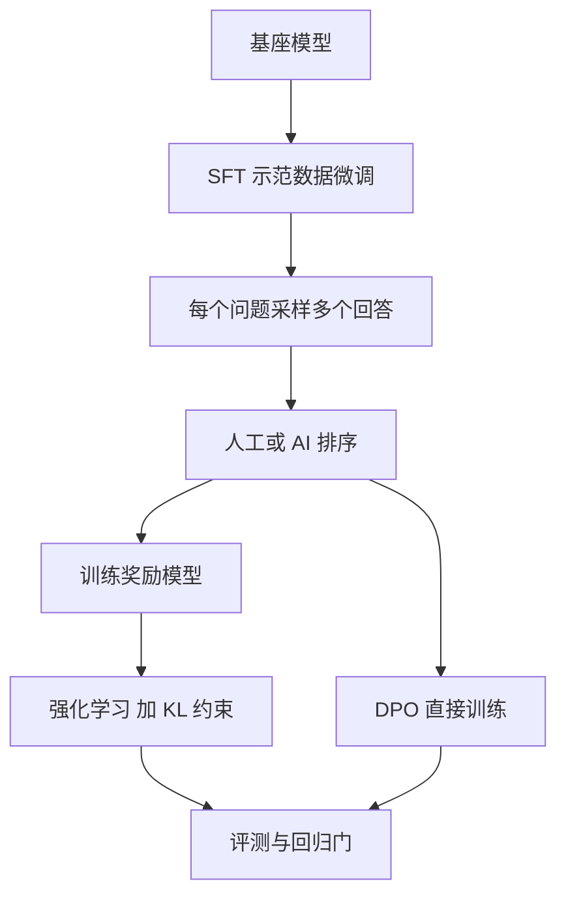

## Q
**深挖 · 偏好对齐流水线**｜对话助手

面试官：「对话助手的指令微调和偏好对齐具体怎么做？偏好数据从哪来？RLHF 和 DPO 你选哪个？」

## A
**一句话。** 指令微调（SFT，用人工写的"问题—好回答"示范继续训练）教会模型回答的格式；偏好对齐用"两个回答哪个更好"的比较数据教会它取舍。RLHF 先训练一个给回答打分的奖励模型，再用强化学习让对话模型追高分；DPO 跳过奖励模型，直接在成对数据上训练，更简单稳定，是多数团队的默认起点。

**步骤。**
1. **SFT：** 数万条示范，按对话模板（用特殊 token 标出系统、用户、助手各自说的话）拼成文本，只对助手那段算损失（只让模型学"该怎么答"，不学去背用户的问题）。
2. **采样：** 用 SFT 模型对每个问题生成 4–9 个回答，问题来自真实用户请求（脱敏）和标注员编写。
3. **标注偏好：** 标注员按有用、诚实、无害排序；也可用强模型按书面准则打分（RLAIF，AI 反馈），便宜但要用人工样本校准。一组 9 个回答的排序能拆出 36 对比较。
4. **RLHF 路线：** 奖励模型（reward model，输入问题和回答、输出一个分数）在成对数据上学"好的比差的分高"；再让对话模型生成、奖励模型打分、按分数调参数（常用 PPO 算法）。同时加 KL 惩罚，即惩罚新模型的输出概率偏离 SFT 模型太远。
5. **DPO 路线：** 直接用"好回答 vs 差回答"调整模型，让好回答的概率相对差回答升高，同样以 SFT 模型为参照，不需要奖励模型，也不需要在训练中实时生成。
6. **回归门：** 对齐后重跑能力基准和安全集，确认没有退化再进入发布流程。

**故障与处理。**
- **奖励作弊（reward hacking）：** 模型学会讨好奖励模型而不是讨好人，例如越写越长、到处加免责声明。处理：KL 惩罚、按长度归一的评测、定期用新数据重训奖励模型。
- **过度拒答：** 安全数据偏多时，连"怎么杀死一个 Linux 进程"都拒绝。处理：在评测集里单独量误拒率，偏好数据里放"该答却拒了"的反例。
- **对齐税：** 对齐后数学、代码等能力下降。处理：训练时混入一部分预训练数据，回归门卡住退化。
- **标注不一致：** 两个标注员意见经常相反。处理：书面准则、抽样复标、量一致率，分歧大的样本剔除或请专家裁决。

**为什么这样，不那样。**
- **为什么不只做 SFT：** 示范只告诉模型"一个好答案"，不告诉它"哪个更好"；而且让人排序比让人从头写好答案便宜得多。
- **DPO 优先：** 少训练一个模型、不需要训练中实时生成，工程简单、结果稳定；RLHF 的上限可能更高，但调参难、成本高。
- **AI 反馈不能全替代人：** 评委模型有自己的偏好（如偏爱长回答），需要人工样本做锚。

**数字。** 一个公开的经典规模：SFT 约 1.3 万个问题，奖励模型约 3.3 万个，强化学习阶段约 3.1 万个问题。对齐数据量比预训练小好几个数量级，但对用户感受的影响最大。
