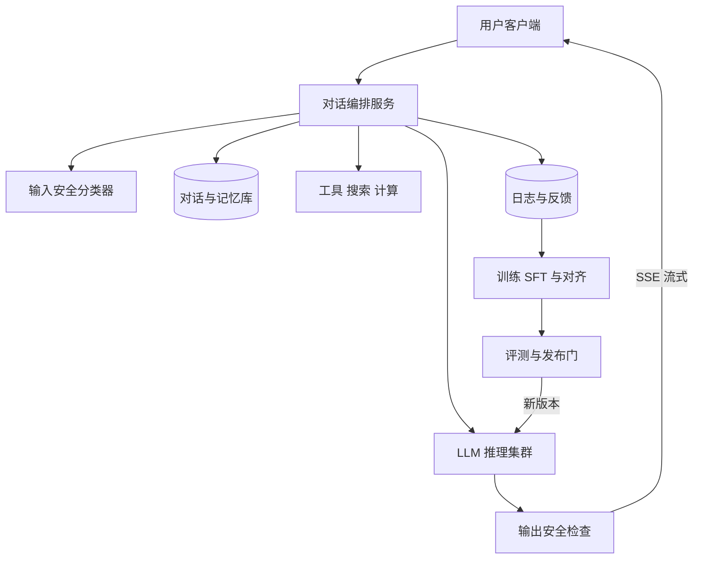

## Q
**全景**｜完整答案 · 对话助手

面试官：「设计一个类似 ChatGPT 的通用对话助手：用户多轮聊天，回答逐字流出，要有用、诚实、安全。按 ML 系统设计的七步，从需求讲到上线后的监控。」

## A
**一句话。** 核心是一个大语言模型（LLM，按"预测下一个 token"训练出来的超大神经网络；token 是文字切成的小片段，英文平均约 4 个字符一个）。它经过预训练、指令微调、偏好对齐三阶段做出来；线上在它前后各加一道安全检查，用对话历史和长期记忆拼出提示，流式返回；用户反馈回流成下一版的训练数据。

**① 需求。**
- **功能：** 多轮对话、流式输出、停止与重新生成、点赞点踩、可调用搜索等工具。不做：图片输入、插件市场。
- **非功能：** 首 token 延迟（TTFT，从发出到看见第一个字）P95 < 1 秒；生成 ≥ 20 token/秒，比人读得快；有害回答率低于约定阈值。
- **规模（假设）：** 1,000 万日活 × 每人 10 轮 = 1 亿轮/天，约 1,160 轮/秒，峰值按 3 倍约 3,500 轮/秒。每轮输入约 1,000 token、输出约 300 token，峰值输出约 100 万 token/秒，这个数决定 GPU 数量。

**② 定义成 ML 任务。** 输入是"系统提示 + 对话历史 + 新问题"，输出是回答文本，属于条件文本生成。训练目标分三层：预训练学续写，指令微调学"被问就答"，偏好对齐学"两个回答里人更喜欢哪个"。

**③ 数据。**
- **预训练：** 万亿 token 级的网页、书、代码，要去重、去有害内容、去个人信息。
- **指令微调（SFT）：** 数万条"指令—好回答"示范。
- **偏好对齐：** 数万组"同一问题的几个回答，哪个更好"的人工排序。
- **上线后：** 点赞点踩、重新生成（隐含"上一个不好"）、人工抽检。

**④ 模型。** 只用解码器的 Transformer（逐个 token 往后生成的网络结构）。尺寸是第一个取舍：7B 参数（70 亿个可调数字）便宜快，70B 质量高。常见做法是大模型做旗舰，简单问题路由给小模型。

**⑤ 评估。** 离线：能力基准、业务评测集、安全红队集、新旧版成对人工比较。在线：A/B 实验看点赞率、重新生成率、留存，护栏指标看有害率、误拒率和延迟。

**⑥ 部署。** 推理服务做连续批处理（多个请求拼在一起算，GPU 利用率高）；前置输入安全分类器，后置输出检查；SSE（服务器单向推送的 HTTP 长连接）流式返回。

**⑦ 监控。** 系统：延迟、吞吐、错误率。质量：点踩率、拒答率、有害率。数据：用户话题与语言分布的漂移。

**必讲深挖。**
- **对齐流水线：** 偏好数据怎么来，奖励模型，RLHF 与 DPO 的取舍。
- **安全层：** 输入输出两道检查，越狱与提示注入。
- **工具调用：** 让模型查实时信息、做精确计算。
- **长期记忆：** 跨会话记住用户事实，并能删除。
- **发布前评测：** 分层评测与发布门。

**级别。** 中级能走完七步；高级讲清对齐取舍和安全的误杀漏杀；Staff 还讲每百万 token 成本、评测体系和发布节奏。
