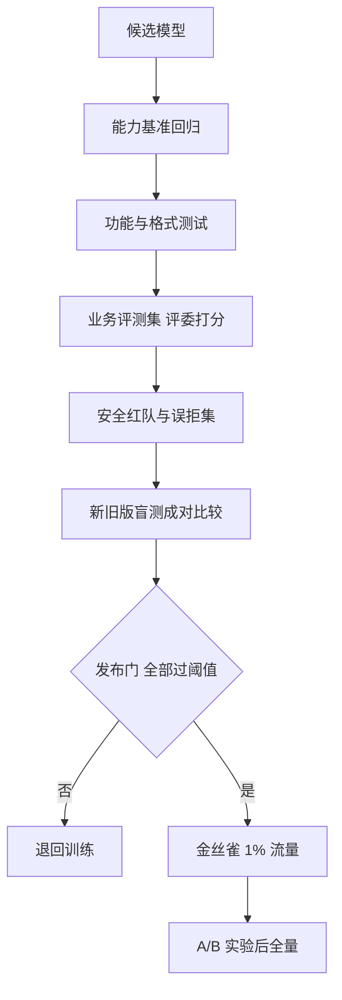

## Q
**发布前测试与评估**｜对话助手

面试官：「新一版对话模型训练好了。上线前你怎么测试和评估它？满足什么条件才允许发布？」

## A
**一句话。** 分层过关：先跑自动能力基准确认没退化，再跑业务评测集（规则检查加 LLM 当评委），再跑安全集（有害率、误拒率），再做新旧版盲测成对比较，最后小流量上线看真实指标。安全是硬门槛，一项不过就不发；质量看新版对旧版的胜率和置信区间。

**步骤。**
1. **能力回归：** 知识问答、数学、代码（生成的代码跑单元测试，算通过率）等公开基准，与上一版逐项对比；任何一项下降超过事先定的容差（例如 1 个百分点）就要解释。
2. **功能测试：** 不是模型能力，而是系统行为：对话模板是否正确、停止符是否生效、长上下文是否被截断、流式和非流式结果一致、多语言、工具调用格式合法。
3. **业务评测集：** 几千条脱敏的真实问题，按类别分层（写作、编程、问答、闲聊）。能写规则的写规则（格式、长度、是否引用）；不能的用更强的模型当评委按评分细则打分。评委先在几百条人工标注上校准，和人的一致率够高才用。
4. **安全：** 有害请求集量拒答率；"看着危险其实无害"的问题集量误拒率；越狱集量被攻破率。三者都有阈值。
5. **成对比较：** 同一问题新旧版各答一次，评委或人工盲评选更好的一个，算胜率。每对比较要交换左右位置再评一次，抵消评委偏爱某个位置。
6. **线上：** 1% 金丝雀先看错误率和延迟；再做 A/B 实验看点赞率、重新生成率、会话长度，护栏看投诉和有害率。

**故障与处理。**
- **评测集污染：** 题目混进了训练数据，分数虚高。处理：保留不公开的私有集，定期换题，检查训练数据与评测题的文本重叠。
- **评委偏差：** LLM 评委偏爱长回答、偏爱和自己风格相近的回答。处理：评分细则里写明长度不加分，交换位置，人工抽检。
- **平均数掩盖退化：** 总分涨了，但某种语言或某类问题明显变差。处理：按类别分别设门槛。
- **离线好线上差：** 评测集和真实流量分布不同。处理：评测集定期用最新线上样本刷新。

**为什么这样，不那样。**
- **不只看公开基准：** 公开基准测的是通用能力，和自家用户的问题差很远，也容易被污染。
- **不只靠人工：** 人工最准但慢且贵，只用在最后的成对比较和评委校准上。
- **不跳过小流量：** 很多问题（延迟、某类罕见问题）只有真实流量才暴露。

**数字。** 成对比较的胜率误差约为 1.96 × √(0.25 ÷ n)：要把误差压到 ±3 个百分点，需要约 1,070 对（1.96² × 0.25 ÷ 0.03² ≈ 1,067）。所以"新版胜率 53%"在只有 200 对时说明不了任何事。
