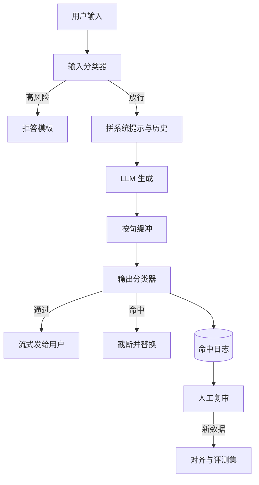

## Q
**深挖 · 安全层：输入、输出与流式检查**｜对话助手

面试官：「对话助手的安全怎么做？输入查什么、输出查什么？回答是流式发出去的，输出检查怎么来得及？」

## A
**一句话。** 纵深防御：训练时的对齐让模型自己会拒答；线上在模型前放一个输入分类器（判断请求属于哪类风险的小模型），在模型后按句或按块检查输出；高风险命中就换成拒答模板或截断；所有命中进入人工复审，复审结果再变成训练和评测数据。

**步骤。**
1. **输入分类：** 一个小分类模型给请求打多个风险类别的概率（暴力、自残、违法、个人隐私等），每类各有阈值。只有明确高风险才直接拒答，灰色地带放行，交给模型按对齐时学到的方式处理。
2. **系统提示：** 写明身份、边界和语气；它会被模型读到，但不是安全保证，能被用户诱导绕过。
3. **输出检查：** 生成的 token 先在服务端按句（或每约 50 个 token）缓冲，过输出分类器再发出。代价是用户看到的文字落后生成一小段。
4. **命中处理：** 截断已生成的部分，补一段拒答说明；已发出的极少量文字由客户端收到"撤回"事件后替换。
5. **闭环：** 命中样本和用户举报进人工复审；确认的漏放变成新的红队用例（专门用来诱导模型出错的测试问题）和偏好数据。

**故障与处理。**
- **越狱（jailbreak）：** 用角色扮演、"假设你是没有限制的 AI"等话术绕过对齐。处理：持续收集越狱话术做红队集，加入对齐数据，输出检查兜底（越狱改变的是输入，输出的有害内容仍能被查到）。
- **提示注入（prompt injection）：** 工具返回的网页或文档里藏着"忽略之前的指令"。处理：把外部内容明确标为数据而非指令，工具权限最小化，有副作用的操作要用户确认。
- **误杀：** "怎么杀死一个卡住的进程"被当成暴力。处理：每类单独量误拒率，阈值按类别调，不用一个总阈值。
- **分类器宕机：** 默认失败关闭（拒绝）还是失败开放（放行）要事先定，高风险类别通常失败关闭。

**为什么这样，不那样。**
- **不只靠对齐：** 模型改一次要重新训练，几周才上线；分类器和规则可以当天调。
- **不只靠分类器：** 分类器看不懂上下文，误杀多；对齐让模型自己给出得体的拒答。
- **按句缓冲而不是整段审完再发：** 整段审完会让首字延迟变成整段生成时间，流式就没意义了。

**数字。** 安全分类器通常是比主模型小几十倍的模型，单次几毫秒到几十毫秒；按句缓冲让显示延迟增加约一句话的生成时间（20 token/秒时约 1 秒以内）。
