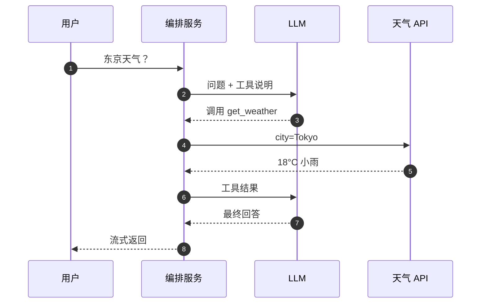

## Q
**深挖 · 工具调用（function calling）**｜对话助手

面试官：「用户问"今天东京天气怎样""37 × 4,129 等于多少"。模型的知识停在训练截止日，心算也不可靠。怎么让对话助手调用外部工具？」

## A
**一句话。** 把每个工具的名字、用途说明和参数格式（JSON Schema）写进提示；模型想用工具时不输出普通文字，而是输出一段结构化的调用请求；编排服务校验并执行这个调用，把结果作为一条新消息放回对话，再让模型接着生成；循环到模型给出最终回答或达到步数上限。模型只"提出"调用，真正执行的永远是编排服务。

**步骤。**
1. **注册工具：** 每个工具一份定义：`name`、`description`（写清何时该用）、`parameters`（JSON Schema，规定字段和类型）。
2. **第一次生成：** 模型在微调时学过一种特殊输出格式，表示"我要调用某工具，参数如下"。编排服务识别出这段输出，不发给用户。
3. **校验与执行：** 按 Schema 校验参数；查权限；带超时调用工具；结果截断到固定长度（例如 2,000 token）防止撑爆上下文。
4. **回填：** 结果以"工具消息"角色加入对话，再次调用模型。模型可以继续调别的工具，也可以直接回答。
5. **收尾：** 达到最大步数（例如 5–10 步）就停止，让模型基于已有结果作答并说明不确定。

**故障与处理。**
- **参数不合法：** 模型输出的 JSON 缺字段或类型不对。处理：约束解码（生成时只允许符合 Schema 的 token），或者把错误信息回填让模型重试一次。
- **工具超时或报错：** 不要让整轮失败；把"工具失败：超时"作为结果回填，模型会改用别的方式或如实告知。
- **死循环：** 模型反复调用同一个工具。处理：步数上限和重复调用检测。
- **有副作用的操作：** 发邮件、下单这类不可撤回的动作，执行前必须让用户确认，并带幂等键（同一个调用重放时只执行一次）。
- **注入：** 搜索结果里的文字可能包含伪造的指令；编排服务只执行模型发出的结构化调用，并对高危工具单独授权。

**为什么这样，不那样。**
- **不把知识都训练进模型：** 训练数据有截止日期，实时信息只能靠外部查询；精确计算交给计算器比让模型逐 token 猜数字可靠。
- **和检索增强（RAG）的区别：** RAG 每次都先检索再生成，流程固定；工具调用由模型自己判断要不要查、查什么，更灵活，但多一次模型往返，也多一种出错方式。
- **执行权在编排服务：** 模型可能被诱导，所以权限、校验、确认都在确定性的代码里，不在提示里。

**数字。** 每多一次工具往返，就多一次模型的完整前向计算加上工具延迟（几百毫秒到几秒），首字延迟随之增加，所以简单问题不应触发工具。
