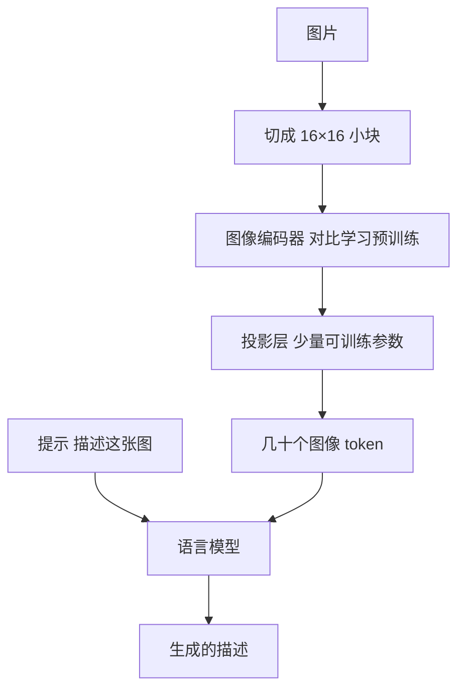

## Q
**深挖 · 图像编码器怎么接到文本解码器**｜图像描述生成

面试官：「图像描述模型里，图片的信息怎么传给生成文字的那部分？编码器从哪来，要不要和解码器一起训练？直接用一个多模态大模型行不行？」

## A
**一句话。** 先用海量图文对做对比学习，得到一个"图片向量和对应文字向量靠得近"的图像编码器；再用两种方式之一接到文本解码器：交叉注意力（解码器每生成一个词都去查询图像向量）或投影前缀（把图像向量投影成几十个"假 token"，拼在文字前面交给语言模型）。资源有限时冻结编码器和语言模型，只训练中间的连接层。

**步骤。**
1. **对比学习预训练：** 一批里有 N 张图和 N 段文字；训练目标让配对的图文向量相似度最高、不配对的低。规模化的公开做法用了约 4 亿个图文对，得到的编码器不需要人工类别标签就能理解图片内容。
2. **把图变成 token：** 视觉 Transformer 把 224×224 的图切成 14×14 = 196 个小块，每块输出一个向量。
3. **连接：** 投影前缀方式把这些向量（或压缩后的几十个）用一个小网络映射到语言模型的词向量空间，语言模型把它们当成一段特殊的"文字"来读。
4. **训练：** 第一阶段只训练投影层，让两边"对上话"；第二阶段可以解冻语言模型的一部分，用高质量描述数据微调。
5. **生成：** 束搜索或低温度采样，设最大长度，避免啰嗦。

**三种方案对比。**
- **专用小模型（编码器 + 小解码器，交叉注意力）：** 几亿参数，快且便宜，适合每天上亿张图的批量描述；但描述较模板化。
- **冻结编码器 + 冻结语言模型 + 训练连接层：** 训练成本低，借用语言模型的表达能力。
- **完整多模态大模型：** 能按指令写不同风格、回答图片相关的问题，质量最好；但每张图成本高一到两个数量级，延迟也高。

**故障与处理。**
- **网页替代文本太嘈杂：** "IMG_2034.jpg"、"点击购买"。处理：用对比学习模型给图文对打相关分，低于阈值的丢掉；或者用已有的好模型重新写描述。
- **编码器分辨率低：** 224×224 看不清截图里的小字。处理：截图类图片切块后分别编码，或用高分辨率编码器。
- **语言模型"脑补"：** 强语言模型凭常识写出"桌上有一杯咖啡"。处理：训练数据去掉含图中不存在物体的描述，评估时专门量物体幻觉率。

**为什么这样，不那样。**
- **不从零训练编码器：** 人工标注的描述数据只有十几万张，远不够学会"看"。
- **冻结大部分参数：** 少量数据微调全部参数容易过拟合（在训练集上记住答案，在新图上变差），也容易破坏语言模型原有的能力。
