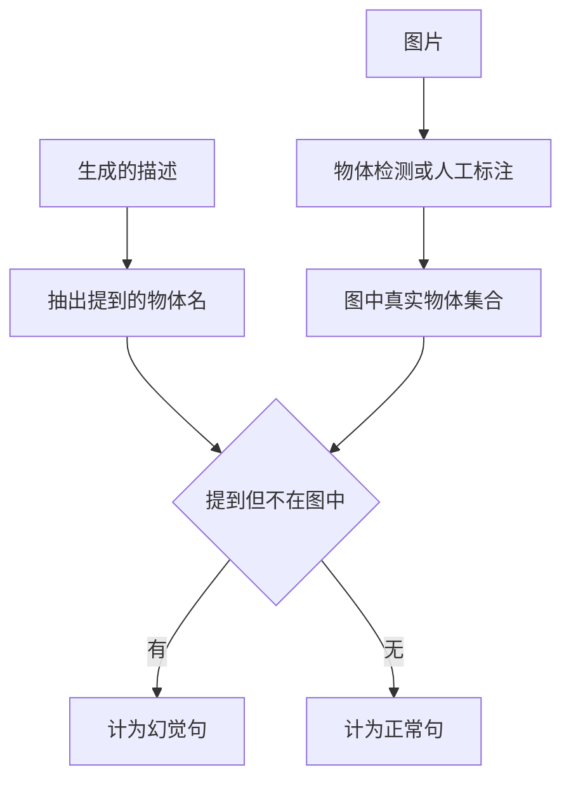

## Q
**深挖 · 描述质量评估与物体幻觉**｜图像描述生成

面试官：「图像描述怎么评估？BLEU、CIDEr、CLIPScore 分别量什么？模型说图里有一只狗但其实没有，怎么系统地发现？」

## A
**一句话。** 三类指标互补：和人工参考描述比的词片段指标（BLEU、CIDEr），不需要参考描述、直接比图文相符程度的模型指标（CLIPScore），以及专门的错误指标（物体幻觉率）；最后用人工评分做发布决定。幻觉用"描述里提到的物体"对比"图里真实有的物体"来量。

**各指标量什么。**
- **BLEU：** 生成描述与参考描述的 1–4 词片段重合率。描述可以有很多种正确写法，所以 BLEU 和人工判断的一致性在这里尤其弱。
- **CIDEr：** 也是词片段，但和一张图的多条（通常 5 条）参考描述比，并按 TF-IDF 加权：大家都提到的、又能区分这张图的词（"冲浪板"）权重高，任何图都能说的词（"一张图片"）权重低。描述类任务最常用的离线指标。
- **CLIPScore：** 用图文对比学习模型分别编码图片和描述，算两个向量的相似度。不需要参考描述，所以可以在线上全量计算；缺点是它对数量、位置关系（"左边""三只"）不敏感。
- **物体幻觉率：** 有幻觉的句子占比，以及幻觉物体占所有提到物体的比例。

**幻觉评估的步骤。**
1. 准备一批图，每张图有完整的物体标注（人工或可信的检测模型）。
2. 从生成描述里抽出物体名，同义词归一（"小狗""狗"→狗）。
3. 提到但不在标注集合里的就是幻觉，按句和按物体分别统计。
4. 按图片类型拆分：杂乱的室内场景通常幻觉最多。

**人工评分。** 评分员按准确（有没有错）、完整（主要内容提到没有）、有用（对读屏用户是否有信息量）三项打分。发布门以准确为硬门槛。

**故障与处理。**
- **指标涨了但描述变空泛：** 模型学会说"一个人站在室外"，安全但没信息。处理：人工评"有用"一项，统计空泛模板句的比例。
- **敏感推测：** 描述里写"一位老年亚裔男性"。处理：训练数据去掉种族、健康等推测，输出侧规则过滤，评测集里放专门的人像图量违规率。

**为什么这样，不那样。**
- **不只看 CIDEr：** 它奖励"和参考相似"，不惩罚"说了图里没有的东西"，而读屏场景里一个幻觉物体比少说一个物体伤害大得多。
