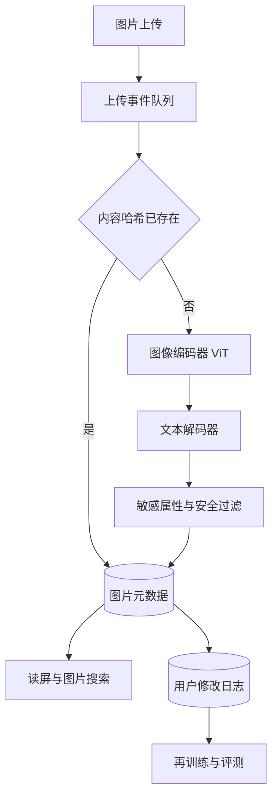

## Q
**全景**｜完整答案 · 图像描述生成

面试官：「用户上传图片时自动生成一句描述，用作视障用户读屏的替代文本，也用于图片搜索。设计这个图像描述系统，按 ML 系统设计的七步讲。」

## A
**一句话。** 图像编码器（把图片变成一组向量的网络）读图，文本解码器（逐词生成句子的语言模型）看着这组向量写描述；用大量"图片—描述"对训练；上传后异步生成并存储，结果供读屏和搜索使用。难点是描述准确（不说图里没有的东西）和不对人做敏感推测。

**① 需求。**
- **功能：** 每张上传图片生成一句 10–30 词的描述；支持多语言；用户可修改。
- **非功能：** 上传后几秒内可用（异步即可）；描述里不能出现图中不存在的物体；不猜测人的种族、年龄、健康状况。
- **规模（假设）：** 每天 1 亿张图，平均约 1,160 张/秒，峰值约 3,500 张/秒；单张推理约几十毫秒 GPU 时间，批处理后少量 GPU 集群即可。

**② 定义成 ML 任务。** 条件文本生成：输入图片，输出描述。训练目标是逐词预测参考描述（交叉熵）。

**③ 数据。** 人工标注的高质量数据（每张图 5 条人工描述的经典公开数据集约十几万张）；网页图片和它的替代文本，量可达数亿但很嘈杂，需要过滤（图文相关度低的去掉）；用户修改过的描述作为新的高质量标签。

**④ 模型。** 编码器常用视觉 Transformer（ViT，把图片切成 16×16 像素的小块，每块当一个 token 处理），先用图文对比学习预训练；解码器是一个语言模型，通过交叉注意力或投影层读取图像向量。

**⑤ 评估。** 离线：CIDEr（和多条人工描述的词片段共识程度）、CLIPScore（用图文匹配模型直接量描述和图片的相符程度，不需要参考描述）、物体幻觉率；人工评分：准确、完整、有用。在线：用户修改率、读屏用户反馈、图片搜索点击率。

**⑥ 部署。** 上传事件进队列，GPU 工作节点批量生成，结果写入图片元数据；按图片内容哈希缓存，同一张图不重复算。

**⑦ 监控。** 生成失败率和延迟；描述长度分布、"一张……的图片"这类空泛描述的比例；用户修改率按图片类型拆分（截图、文档照片、风景）。

**必讲深挖。**
- **模型结构：** 编码器如何接到解码器，冻结还是一起训练，和多模态大模型的取舍。
- **评估与幻觉：** 指标各量什么，物体幻觉怎么测，敏感属性怎么处理。

**级别。** 中级讲清编码器加解码器和 BLEU、CIDEr；高级讲清连接方式、数据清洗和幻觉评估；Staff 还讲无障碍场景的产品要求、多语言和成本。
