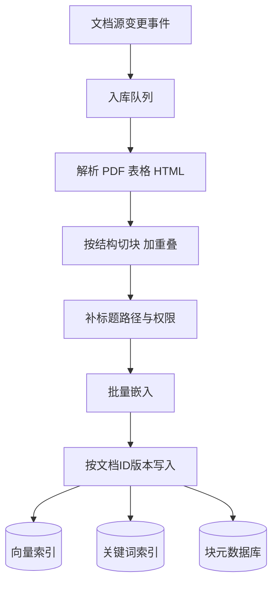

## Q
**深挖 · 切块与入库流水线**｜文档问答（RAG）

面试官：「文档问答系统里，文档怎么切块？块多大？文档更新、删除和权限变化怎么同步到索引？」

## A
**一句话。** 按文档自身结构（标题、段落、表格）切，块大小约 300–800 token，相邻块重叠约 10–20%，每块带上所属文档标题和章节路径；入库是一条由变更事件驱动的异步流水线，按"文档 ID + 版本"幂等写入，删除和权限变更同步到每个块。

**步骤。**
1. **变更捕获：** 文档系统的 webhook 或定时增量扫描，把"新建、修改、删除、权限变更"事件放进队列。
2. **解析：** PDF 抽文字并保留标题层级；表格转成 Markdown 表格整块保存，不从中间切开；扫描件先做文字识别。
3. **切块：** 先按标题切成章节，章节太长再按段落切到目标长度，最后才按句子切。相邻块重叠一两句，防止一个答案被切成两半。
4. **补上下文：** 每块前面加"文档标题 > 章节标题"，否则一个只写"该参数默认是 30 秒"的块，脱离文档后看不出在说哪个参数。
5. **嵌入与写入：** 批量调用嵌入模型；以"文档 ID + 版本号"为键：先写新版本的所有块，再删旧版本的块，重放同一事件结果不变。
6. **权限：** 每块存文档的权限组列表；权限变化只改元数据，不用重新嵌入。

**故障与处理。**
- **解析失败：** 加密或损坏的文件进死信队列，报到数据源负责人，不阻塞其他文档。
- **半新半旧：** 新块写了一半时被查询看到。处理：查询只取"当前版本号"的块，版本号在全部写完后才切换。
- **嵌入模型升级：** 新旧模型的向量不能混用。处理：建一个新索引全量重建，评测通过后切流量，旧索引保留以便回滚。
- **重复文档：** 同一份文档有多份拷贝，检索结果被同一内容占满。处理：入库时用内容哈希或近似去重。

**为什么这样，不那样。**
- **块不能太大：** 一块里混了几个话题，嵌入向量变成"平均意思"，和具体问题都不太像；还浪费提示里的 token。
- **块不能太小：** 一句话缺上下文，检索到了也答不了。
- **按结构切优于按固定长度切：** 固定 512 token 一刀会切断表格、代码和列表。
- **权限放在块上，而不是查询后再查文档系统：** 后者每次查询要调外部系统几十次，慢且容易漏。

**数字。** 200 万块 × 1,024 维 × 4 字节 ≈ 8 GB 向量，单机内存放得下。嵌入 10 亿 token 是一次性的批任务；之后每天只处理变更的文档。
