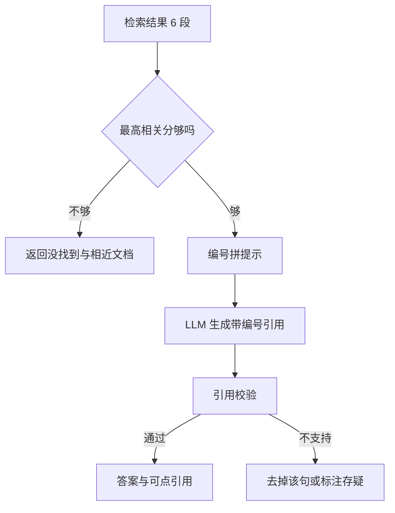

## Q
**深挖 · 有依据的生成：提示、引用与拒答**｜文档问答（RAG）

面试官：「检索到 6 段材料后，怎么让大语言模型只根据材料回答、每句标出处、材料不够时说不知道？怎么检测它编了东西？」

## A
**一句话。** 提示里给每段材料编号，指令要求"只用材料、每个论断后标 [编号]、材料不足就说没找到"；生成后由后处理校验引用编号存在且对应的段落确实支持那句话；整体相关度低时根本不调用生成，直接返回"没找到"和最接近的几篇文档。

**步骤。**
1. **提示结构：** 系统指令在前；材料按 `[1] 标题 > 章节 / 正文` 的格式列出；用户问题放最后。最相关的材料放在开头和结尾附近，因为模型对超长输入中间部分的注意最弱。
2. **指令要点：** 只依据材料作答；每句事实后加 `[n]`；材料互相矛盾时指出矛盾并以更新日期较新的为准；材料不足时明说，不用常识补。
3. **生成：** 温度设低（温度是控制随机性的参数，越低越倾向选概率最高的词），减少自由发挥。
4. **引用校验：** 把答案切成句子，检查每个 `[n]` 都在材料范围内；再用一个小的蕴含判断模型（NLI，判断"材料 A 能否推出句子 B"）或 LLM 评委核对是否真被支持。
5. **展示：** 引用链接到原文的具体位置；用户可一键反馈"引用不对"。

**故障与处理。**
- **编造引用：** 模型写了 `[7]`，但只给了 6 段。处理：后处理直接发现并去掉。
- **引用对了但内容是编的：** 句子和段落对不上。处理：蕴含校验，不支持的句子删掉或标"未在文档中找到依据"。
- **材料过期：** 两版政策都被检索到。处理：材料里带更新日期，指令要求优先新的；入库时旧版本已删除就不会出现。
- **材料里藏指令：** 某个文档写着"忽略上面的规则"。处理：材料包在明确的分隔符里，并告诉模型材料是数据不是指令。

**为什么这样，不那样。**
- **先判相关度再生成：** 模型拿到无关材料时仍倾向于"凑一个答案"，在生成前拦住最便宜。
- **句子级引用而不是只列参考文档：** 用户能逐句核实，评测也能逐句量忠实度。
- **校验用小模型：** 每句一次判断，用大模型太贵；小模型几十毫秒就够。

**数字。** 6 段 × 500 token ≈ 3,000 token 材料，加指令和问题约 3,500 token 输入；答案约 300 token。输入越长首字越慢，所以重排后的条数是延迟与召回的直接取舍。
