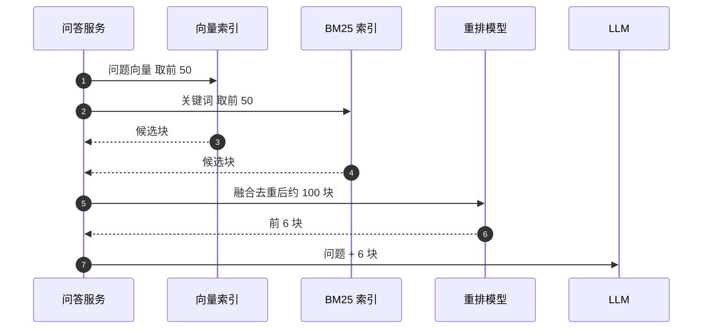

## Q
**深挖 · 混合检索与重排**｜文档问答（RAG）

面试官：「只用向量检索够吗？员工搜"ERR_4012 是什么错"时找不到。检索部分你怎么设计，才能既懂意思又不漏关键词？」

## A
**一句话。** 两路召回再精排：语义检索（问题和文档块都变成嵌入向量，找最接近的）擅长同义改写，关键词检索（BM25，按词出现频率打分）擅长错误码、产品名、人名；两路各取前 50，用倒数排名融合（RRF）合并、按权限过滤，再用重排模型从约 100 个候选里挑出最好的 5–8 个交给大语言模型。

**步骤。**
1. **查询改写：** 多轮对话里"那它的默认值呢"要先用小 LLM 改写成完整问题；可选地再生成 2–3 个改写版本一起检索，提高召回。
2. **两路召回：** 向量检索用近似最近邻索引（ANN，用少量精度换几十倍速度的相似度搜索）；BM25 走倒排索引（每个词对应出现它的文档列表）。两路都带权限过滤条件。
3. **融合：** RRF 给每个块打分：各路排名 r 的 1 ÷ (60 + r) 相加。只用排名不用原始分数，因为两路的分数尺度完全不同，没法直接比。
4. **重排：** 重排模型是交叉编码器（cross-encoder，把问题和一个块拼在一起读，直接输出相关分），比嵌入的"各自编码再比距离"准得多，但每对都要算一次，所以只用在约 100 个候选上。
5. **截断：** 取前 5–8 块，并设最低相关分；全都低于阈值就走"没找到"分支，不硬答。

**故障与处理。**
- **嵌入模型不懂领域词：** 内部缩写被当成普通词。处理：BM25 兜底；数据够时用"问题—正确块"对微调嵌入模型。
- **权限过滤太严：** 先取前 50 再过滤，可能一个都不剩。处理：在索引查询里带过滤条件（前置过滤），或者按权限组分区建索引。
- **重排拖慢：** 100 对 × 每对几毫秒，在 GPU 上批处理约几十毫秒；超时就退回融合排序，不阻塞回答。
- **同一文档的块挤满结果：** 每个文档最多取 2–3 块，保证多样性。

**为什么这样，不那样。**
- **不只用向量：** 错误码、版本号这类字符串在语义空间里没有"意思"，向量检索经常漏。
- **不只用关键词：** "怎么申请报销"搜不到写着"费用报销流程"的文档。
- **不直接把 100 块都给 LLM：** 提示越长越贵越慢，而且无关块会诱导模型答偏。

**数字。** 两路召回各几毫秒到十几毫秒；重排约 100 对是主要的检索延迟；整个检索段一般控制在 300 ms 内。RRF 里的常数 60 是常用默认值，作用是压低单路排名第 1 的过大权重。
