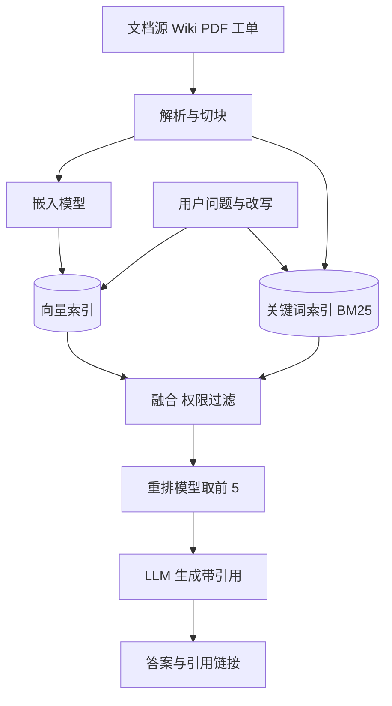

## Q
**全景**｜完整答案 · 文档问答（RAG）

面试官：「公司有 20 万篇内部文档（Wiki、PDF、工单）。设计一个问答系统：员工用自然语言提问，系统给出基于文档的答案并附引用，员工只能看到自己有权限的内容。按 ML 系统设计的七步讲。」

## A
**一句话。** 检索增强生成（RAG，retrieval-augmented generation）：先从文档里找出和问题最相关的几段，再把它们和问题一起交给大语言模型（LLM），要求它只根据这几段回答并标出处。模型不用重新训练，知识更新只要重建索引；难点在检索准不准、模型是否忠于材料、权限是否严格。

**① 需求。**
- **功能：** 提问、带引用的答案、点开引用看原文、反馈对错；文档新增修改后几分钟内可搜到。
- **非功能：** 首字 < 2 秒；答案不能编造（幻觉，hallucination，即模型说出材料里没有的"事实"）；权限零泄漏。
- **规模（假设）：** 20 万篇 × 平均 5,000 token = 10 亿 token；切成 500 token 一块约 200 万块。5 万员工 × 每天 5 问 = 25 万问/天，平均约 3 问/秒，峰值约 10 问/秒。规模不大，难点在质量。

**② 定义成 ML 任务。** 拆成两个任务：检索是排序问题（给定问题，把文档块按相关性排序）；生成是条件文本生成（给定问题和若干块，写出有依据的答案）。

**③ 数据。** 文档本身加元数据（作者、更新时间、权限组）；评测用的"问题—正确文档块—参考答案"集，由领域专家写几百条起步，再从线上日志补充；用户的点赞点踩和点开的引用作为弱标签。

**④ 模型。** 嵌入模型（embedding model，把一段文字变成一串数字，意思相近的文字数字也相近）做语义检索；BM25（按关键词出现频率打分的经典算法）做关键词检索；重排模型（reranker，把问题和一段文字一起读、打相关分的小模型）精排；通用 LLM 生成。一般都用现成模型，只在领域词很特殊时微调嵌入或重排模型。

**⑤ 评估。** 离线分开量：检索的召回率（正确块是否在前 k 个里）、生成的忠实度（每句话有没有材料支撑）和正确率。在线看点赞率、"没找到"比例、引用点击率。

**⑥ 部署。** 入库流水线异步：解析、切块、嵌入、写索引。查询路径同步：改写、双路检索、融合、权限过滤、重排、拼提示、流式生成。

**⑦ 监控。** 检索零结果率、低相似度比例、答案拒答率、点踩率；索引新鲜度（最新文档到可搜的延迟）；嵌入模型升级时的全量重建进度。

**必讲深挖。**
- **切块与入库：** 块多大、按什么边界切、元数据和权限怎么带。
- **混合检索与重排：** 关键词和语义两路互补，重排提精度。
- **有依据的生成：** 提示怎么拼、引用怎么做、没找到时怎么拒答。
- **RAG、微调与长上下文怎么选。**
- **发布前评测：** 检索和生成分开评，组件定位问题。

**级别。** 中级能画出入库和查询两条路径；高级讲清切块、混合检索、忠实度评估的取舍；Staff 还讲权限模型、多数据源治理、嵌入模型升级的迁移和成本。
