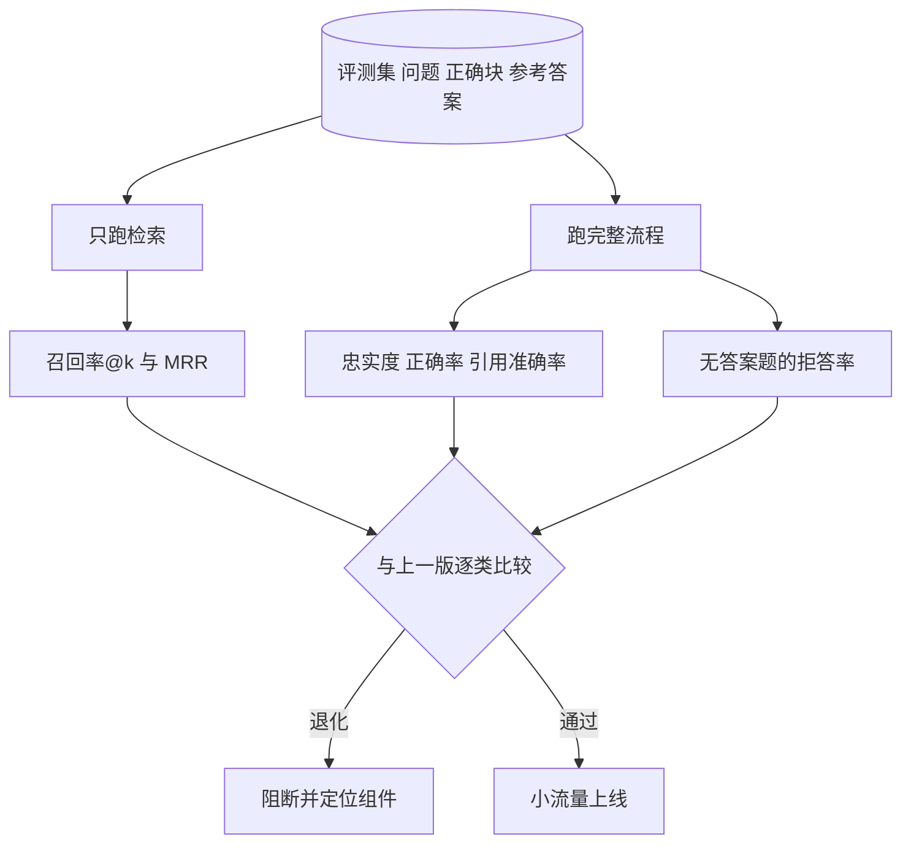

## Q
**发布前测试与评估**｜文档问答（RAG）

面试官：「文档问答系统上线前，你怎么评估它？换了嵌入模型、改了切块大小或换了生成模型以后，怎么知道整体变好还是变坏？」

## A
**一句话。** 建一套带标注的评测集（问题、应被找到的文档块、参考答案），把检索和生成分开打分：检索看召回率和排名，生成看忠实度、正确率和引用准确率；任何一个组件变化都跑全套，按类别对比上一版，过阈值才发布。分开评才能定位：答错了，是没找到材料，还是找到了没用好。

**步骤。**
1. **建评测集：** 领域专家写 300–500 条真实问题，每条标出应被找到的块和参考答案；覆盖简单查找、需要多段拼合、表格数值、错误码、以及文档里根本没有答案的问题（占约 10%）。之后从线上点踩样本里持续补充。
2. **检索指标：** 召回率@k（正确块出现在前 k 个结果里的问题占比）；MRR（第一个正确结果排名的倒数取平均，排第 1 得 1，排第 4 得 0.25）。分别量融合后和重排后，看重排是否真的提升。
3. **生成指标：** 忠实度（答案里有多少句子能在给定材料里找到依据，用蕴含模型或 LLM 评委逐句判）；正确率（与参考答案比，评委打分）；引用准确率（标了 `[n]` 的句子，第 n 段是否真的支持它）。
4. **无答案题：** 材料里没有答案时，系统说"没找到"的比例；这类题最能暴露幻觉。
5. **系统测试：** 权限测试（用低权限账号问只有高权限文档才有答案的问题，必须答不出、也不能在引用里泄露标题）；文档更新后多久能被搜到；空查询、超长查询、多语言。
6. **线上：** 小流量对比点踩率、"没找到"率、引用点击率。

**故障与处理。**
- **评测集太简单：** 全是一段能答的问题，看不出多段推理的退化。处理：按难度和类型分层，每层单独设阈值。
- **评委与人不一致：** 处理：先用 100–200 条人工判分校准评委，一致率够高再用，定期抽检。
- **只看端到端分数：** 分数降了不知道原因。处理：保留每个组件的中间结果，失败样本自动归类为"没检索到"或"检索到但答错"。
- **权限泄漏只在少数文档发生：** 处理：权限测试作为硬门槛，失败一条就阻断。

**为什么这样，不那样。**
- **不只靠 LLM 评委打总分：** 一个总分无法指导改哪个组件。
- **检索指标需要标注到块：** 换了切块方式后块 ID 会变，所以标注要记"文档 + 原文片段"，按文字重叠自动映射到新块上。

**数字。** 500 条题的正确率误差约 ±4 个百分点（1.96 × √(0.25 ÷ 500) ≈ 0.044），所以 2 个百分点以内的变化要靠更多题或多次运行才能下结论。
