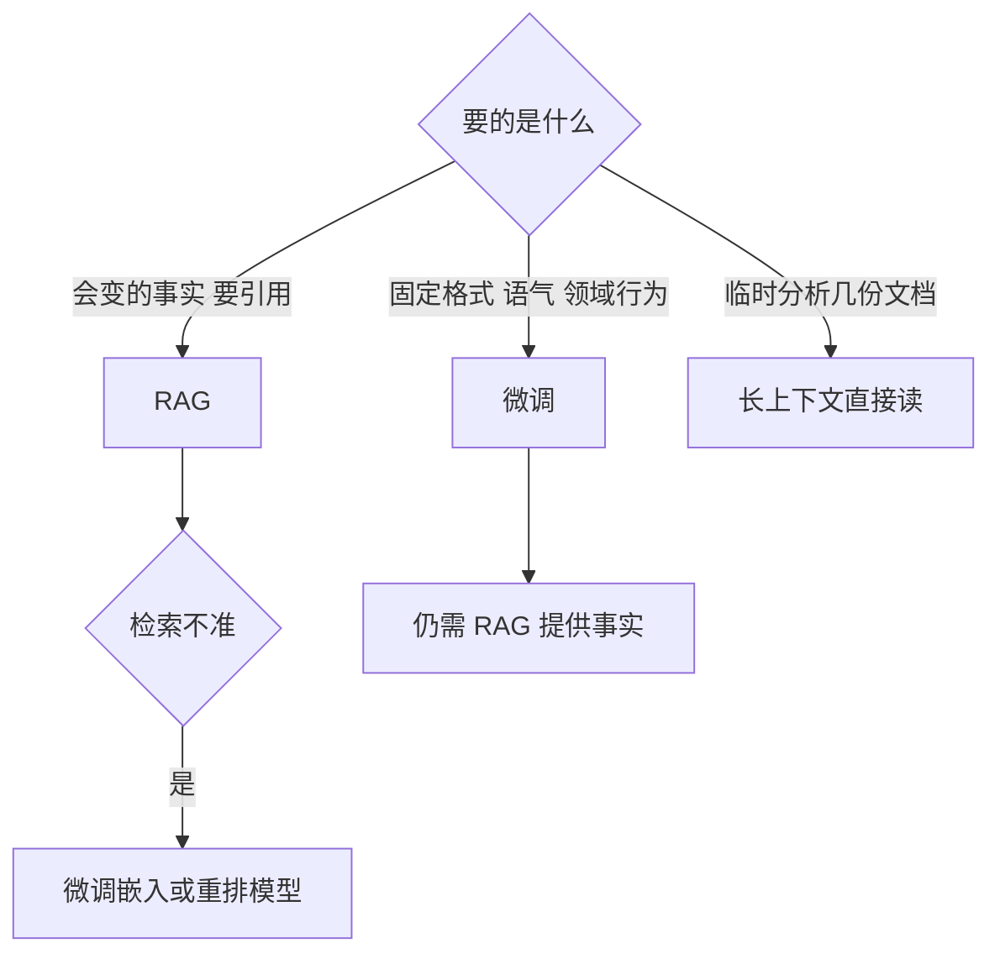

## Q
**深挖 · RAG、微调还是长上下文**｜文档问答（RAG）

面试官：「为什么不直接用公司文档微调模型？现在模型能读几十万 token，为什么不把文档全塞进去？什么时候该用哪种？」

## A
**一句话。** 三者解决的问题不同：RAG 给模型"可更新、可引用、可按权限过滤的知识"；微调（fine-tuning，用自己的数据继续训练模型、改变参数）改变模型的"行为和风格"，不适合灌入会变的事实；长上下文适合"一次性分析少量文档"。知识库问答默认 RAG，必要时在 RAG 之上微调生成模型的格式或微调检索模型。

**三者对比。**
- **知识更新：** RAG 改一篇文档几分钟后生效；微调要重新训练、评测、发布，按周计；长上下文每次请求都带上，即时但每次付费。
- **引用与可核实：** RAG 天然知道答案来自哪一段；微调后的模型说不清知识来自哪条训练数据；长上下文可以引用，但材料越长定位越难。
- **权限：** RAG 按用户过滤检索结果；微调把所有人的文档混进同一组参数，无法按人隔离，也无法精确删除一篇文档。
- **成本：** RAG 每问约 3,000–5,000 token 输入；把 20 万篇、10 亿 token 塞进上下文根本放不下，即使只塞 10 万 token，每问输入成本也是 RAG 的 20–30 倍，首字延迟也长得多。
- **幻觉：** 微调灌事实后，模型会自信地说出半记住的内容；RAG 至少能检查每句话有没有材料支撑。

**微调真正擅长的。**
- **格式与风格：** 每次都按固定模板输出、使用公司术语。
- **领域行为：** 学会"先问澄清问题"或"遇到法律问题转人工"。
- **小模型替大模型：** 用大模型生成的好答案微调小模型，降低成本。

**故障与处理。**
- **用微调灌知识后答案过时：** 文档更新了，模型还在说旧政策，且无法追溯。处理：事实只走 RAG。
- **长上下文"看漏"：** 关键信息在长输入中间时更容易被忽略。处理：先检索缩小范围，再给模型。
- **RAG 检索不准却去微调生成模型：** 生成模型拿不到正确材料，怎么调都没用。处理：先分组件评测，确认问题在检索还是生成。

**数字。** 10 万 token 输入对比 4,000 token 输入，计算量和费用约 25 倍；10 亿 token 的知识库比目前任何模型的上下文窗口大上千倍。
