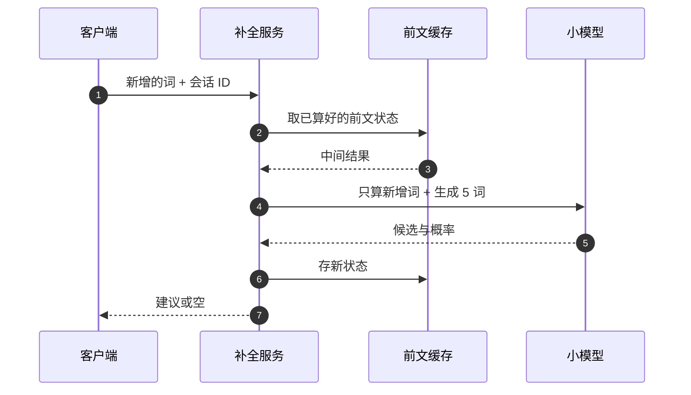

## Q
**深挖 · 60 毫秒的延迟预算**｜邮件智能补全

面试官：「补全建议要在用户敲下一个键前出现，P90 约 60 ms。这 60 ms 怎么分配？模型、计算方式和客户端分别要怎么设计？」

## A
**一句话。** 把预算拆成网络、排队、模型三段，模型只能分到几十毫秒，所以选小模型、只预测几个词、束宽很小，并且复用同一封邮件前文已算过的中间结果（增量计算），每次只算新敲的词；客户端只在词边界触发，新请求发出时取消旧请求。

**步骤。**
1. **预算拆分（示例）：** 网络往返约 20–30 ms，排队与序列化约 5 ms，模型计算约 20–30 ms。模型是唯一能大幅压缩的部分。
2. **模型尺寸：** 几千万参数的小模型。参数少，每生成一个词要读的权重就少，单步计算是亚毫秒到毫秒级。
3. **只预测短序列：** 最多约 5 个词，长了概率连乘后很低，反正也不会显示。
4. **小束宽：** 束搜索每步保留的候选数（束宽）取 2–4；束宽翻倍，计算量大致翻倍。
5. **增量计算：** 模型读前文时会为每个位置算出中间结果（对 Transformer 来说是 KV 缓存，即每个已读 token 的注意力键值）；按会话存起来，用户多敲一个词只需算这一个词。会话亲和路由（同一封邮件的请求落到同一台机器）让缓存命中。
6. **客户端：** 只在空格等词边界触发；上一个请求未返回时用户又敲了键，就取消它；返回结果若与当前光标处的前文不匹配，直接丢弃。

**故障与处理。**
- **超时：** 超过预算的结果已经没用。处理：服务端设截止时间，到点直接返回空，不排队等待。
- **缓存未命中：** 机器重启或路由变化。处理：退回从头计算整段前文，长邮件只取最后几百个 token。
- **高峰排队：** 处理：按队列长度扩容；过载时降级为"只预测 1–2 个词"或暂停显示，而不是变慢。

**为什么这样，不那样。**
- **不用大模型：** 质量更好，但单次计算就超出预算；接受率提升抵不过延迟带来的"建议出现时用户已经打完"。
- **不放在客户端跑：** 端侧免网络延迟、隐私好，但手机和老电脑算力差异大、模型更新慢。常见折中是服务端为主，端侧放极小模型兜底。
- **不每个字符都触发：** 请求量多约 5 倍，而单词中间的预测接受率低。

**数字。** 延迟目标常写成 P90 ≤ 60 ms、整体 100 ms 内人基本察觉不到；约 23 万次请求/秒（1 亿日活假设）时，每次省 10 ms 都是可观的机器数量。
