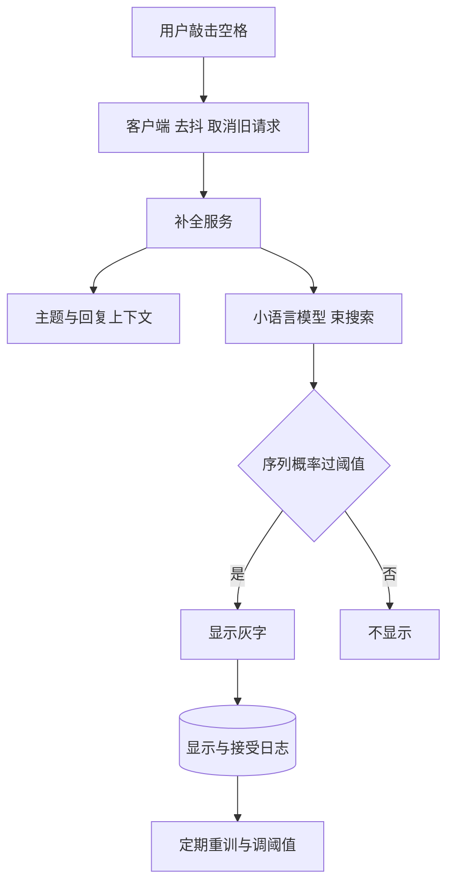

## Q
**全景**｜完整答案 · 邮件智能补全

面试官：「用户写邮件时，在光标后面用灰字提示接下来的几个词，按 Tab 接受。设计这个智能补全功能，按 ML 系统设计的七步讲。」

## A
**一句话。** 一个小而快的语言模型（给定前文、预测下一个词的概率的模型），以"已写的正文 + 主题 + 被回复的邮件"为输入，预测接下来 1–5 个词；只有模型足够有把握时才显示。整个设计被延迟主导：建议必须在用户敲下一个键之前出现。

**① 需求。**
- **功能：** 正文输入时给出灰字建议；Tab 接受，继续打字即忽略；支持多语言；可关闭。
- **非功能：** 建议出现要快到无感，常见目标 P90 约 60 ms、整体 100 ms 内；不能出现冒犯性或带性别刻板印象的建议；不泄露其他用户的邮件内容。
- **规模（假设）：** 1 亿日活 × 每人每天写 5 封 × 每封约 200 次击键 = 1,000 亿次击键/天，约 116 万次/秒。只在词边界（敲空格后）触发，约减少 5 倍，仍是约 23 万次请求/秒，峰值更高。

**② 定义成 ML 任务。** 条件语言建模：输入前文和上下文，输出后续词序列及其概率。产品层面是"显示与否"的决策：序列概率高于阈值才显示。

**③ 数据。** 已发送邮件的正文（去标识、聚合训练、不由人查看）；每个位置的"后面实际写了什么"就是标签，不需要人工标注。按时间切分训练集和评测集，防止用未来邮件评过去。

**④ 模型。** 小型 Transformer 或循环网络，几千万参数级，输入里拼上主题和被回复邮件的编码；解码用宽度很小的束搜索（beam search，每一步只保留几个最可能的候选序列）。

**⑤ 评估。** 离线：ExactMatch@N（预测的前 N 个词与用户实际写的完全一致的比例）、困惑度（模型对真实下一个词有多"意外"，越低越好）。在线：接受率（被接受次数 ÷ 显示次数）、每封邮件节省的击键数、延迟；护栏：用户关闭功能的比例、冒犯性建议投诉。

**⑥ 部署。** 服务端加速器推理；客户端在词边界触发并取消过期请求；服务端缓存同一封邮件前文的中间计算结果，每次只算新增的几个词。

**⑦ 监控。** 延迟分位数、接受率按语言和客户端拆分、显示率、关闭率；新词和新话题（例如节日、新产品名）导致的接受率下降。

**必讲深挖。**
- **延迟预算：** 模型大小、增量计算、束宽、客户端去抖。
- **触发阈值、个性化与偏见：** 显示率与接受率的取舍，个人用词如何融入，避免冒犯性建议。

**级别。** 中级讲清任务定义和接受率；高级讲清延迟预算分解和阈值取舍；Staff 还讲隐私（训练数据不可被模型"背出来"）、多语言推广和成本。
