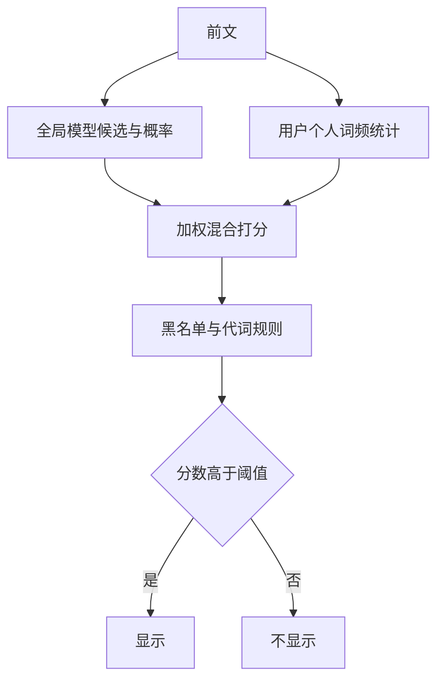

## Q
**深挖 · 触发阈值、个性化与偏见**｜邮件智能补全

面试官：「什么时候显示建议、什么时候不显示？怎么让建议符合每个人的写法？怎么避免模型建议冒犯性或带性别假设的话？」

## A
**一句话。** 显示阈值是"覆盖率 vs 接受率"的取舍，用离线日志画出曲线再按在线实验定；个性化用"全局模型 + 每个用户的轻量统计"混合打分，而不是给每人训练一个模型；偏见和冒犯靠训练数据过滤、输出黑名单和代词规则三层处理。

**步骤。**
1. **阈值：** 对每个候选，模型给出整段的概率。阈值高，显示少但几乎总被接受；阈值低，显示多但很多被忽略，用户会觉得被打扰。用离线回放数据画"显示率—接受率"曲线，选几个点做在线实验，以"每封邮件节省的击键数"为主指标。
2. **长度自适应：** 同一阈值下，有把握时给 5 个词，没把握时只给 1–2 个词。
3. **个性化：** 为每个用户维护一个小的统计表：他常用的短语和签名（例如 n-gram，连续 n 个词出现的次数）。打分时把全局模型的概率和个人统计按权重混合；新用户个人权重为 0，随数据增多逐步增加。
4. **冒犯性：** 训练前过滤含冒犯词的邮件；输出侧有黑名单，命中整条不显示。
5. **性别代词：** 模型从数据里学到"工程师……他"这类关联；对涉及人称代词的建议直接不显示，宁可少给也不给错。

**故障与处理。**
- **背出别人的内容：** 模型可能记住罕见的字符串（电话号码、地址）并建议给别人。处理：训练数据去标识，过滤只出现在极少数用户中的短语；个性化统计只用于本人。
- **接受率下降：** 新话题、新词汇或节日用语。处理：按周重训，监控按语言和地区拆分的接受率。
- **阈值一刀切：** 不同语言模型的概率尺度不同。处理：每种语言单独校准阈值。

**为什么这样，不那样。**
- **不为每人训练模型：** 上亿用户每人一份参数，存储和更新成本不可接受，也难以删除。
- **不追求最大接受率：** 阈值调到极高时接受率接近 100%，但几乎从不显示，节省的击键数反而下降；主指标应是节省量而不是接受率。
- **代词直接不显示而不是"去偏后显示"：** 去偏很难做到完全可靠，而一个错误的代词建议的伤害远大于少一次建议的损失。

**数字。** 接受率和显示率是此消彼长的两条曲线；在线实验通常比较 3–4 个阈值点，每组需要足够多的显示次数才能看出 1 个百分点的接受率差别。
