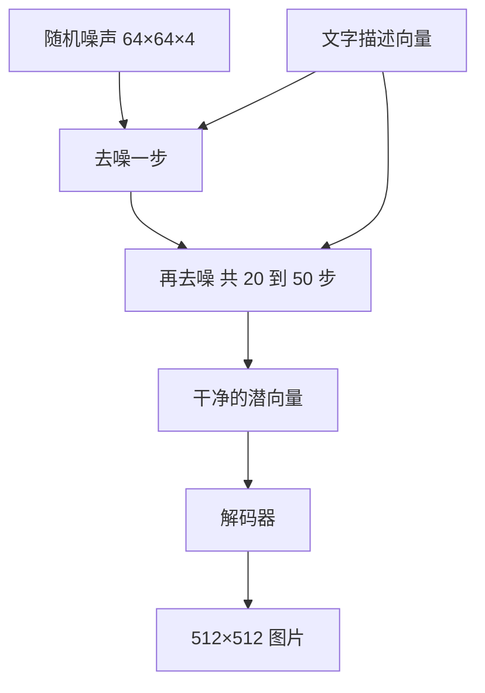

## Q
**深挖 · 扩散模型怎样从噪声画出图**｜文生图服务

面试官：「用不懂 AI 的人能听懂的方式，讲清扩散模型的训练和生成过程。为什么在"潜空间"里做？文字描述是怎么控制画面的？」

## A
**一句话。** 训练时把真实图片一点点加噪声直到变成纯噪声，让模型学"看一张带噪声的图，猜出加进去的噪声"；生成时反过来，从纯噪声出发，每一步减掉模型猜的噪声，几十步后得到清晰图片。为了省算力，这个过程在压缩后的潜空间（图片的压缩表示）里做；文字通过注意力进入每一步，再用"无分类器引导"放大文字的影响。

**训练。**
1. 取一张图和它的描述；随机选一个步数 t（例如 1–1,000 之间）。
2. 按 t 的大小往图里加对应强度的高斯噪声（t 越大，噪声越多）。
3. 把带噪声的图、t、描述向量交给去噪网络，让它输出它认为加进去的噪声。
4. 损失是预测噪声与真实噪声之差的平方。重复几亿次，模型学会在任何噪声程度下"看出"哪部分是噪声。

**生成。**
1. 从纯随机噪声开始（随机种子不同，图就不同）。
2. 每一步：模型预测噪声，采样器（决定每步减多少、怎么减的算法）据此得到稍微干净一点的图。
3. 训练用 1,000 级噪声，但好的采样器生成时只走 20–50 步。

**潜空间。** 一个自编码器把 512×512×3（约 78.6 万个数）的图片压缩成 64×64×4（约 1.6 万个数），少了 48 倍；去噪在这个小张量上做，最后解码一次。代价是极细的细节（小字、手指）由解码器负责，容易出错。

**文字控制与引导。**
- **注意力：** 去噪网络的每一层都可以"查看"描述向量，决定画面哪里该画什么。
- **无分类器引导（classifier-free guidance）：** 每一步算两次噪声预测，一次带描述、一次不带；最终用 不带 + w × (带 − 不带)。w 越大越贴合描述，但颜色过饱和、多样性变差；常用默认值约 7.5。训练时随机丢掉一部分样本的描述，模型才学会"不带描述"的预测。

**取舍。**
- **引导强度：** 贴合描述与画面自然、多样之间的取舍。
- **步数：** 质量与速度的取舍；引导让每一步要算两遍（可以拼成一个批次一起算），成本约翻倍。
- **潜空间：** 速度提升几十倍，换来细节由解码器"补"的风险。
