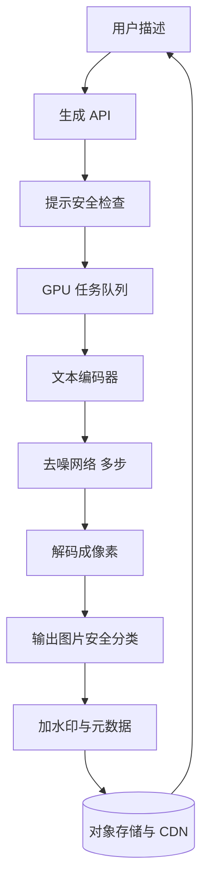

## Q
**全景**｜完整答案 · 文生图服务

面试官：「设计一个文生图服务：用户输入一段文字描述，几秒内得到 4 张 1024×1024 的图片。要保证图片与描述相符、质量高、不生成违规内容。按 ML 系统设计的七步讲。」

## A
**一句话。** 用潜空间扩散模型（latent diffusion）：从一团随机噪声出发，模型在文字描述的引导下分几十步逐步去噪，最后由解码器还原成图片；服务是"提示检查 → GPU 排队批量生成 → 输出检查 → 对象存储加 CDN"的异步流水线；成本几乎全在 GPU 的去噪步数上。

**① 需求。**
- **功能：** 文字生成图片，一次 4 张；可选尺寸和风格；重新生成；下载。
- **非功能：** 首张图 P95 < 10 秒；违规图片率极低；图片带来源标识（水印或元数据）。
- **规模（假设）：** 每天 1,000 万次请求，平均约 116 次/秒，峰值约 350 次/秒。假设一次请求（4 张）在一块 GPU 上约 2 秒，峰值约需 700 块 GPU，所以步数和批处理直接决定成本。

**② 定义成 ML 任务。** 条件生成：给定文字，从"与这段文字相符的图片"的分布中采样。训练目标是：给加了噪声的图片，预测其中的噪声。

**③ 数据。** 数亿到数十亿的图文对；过滤低分辨率、水印、违规内容和图文不符的样本；用图像描述模型为图片重写更详细的说明文字，提升"听懂长描述"的能力；按美学评分挑一小部分高质量数据做最后阶段微调。

**④ 模型。** 三部分：文本编码器（把描述变成向量）、去噪网络（U-Net 或 Transformer，在压缩后的潜空间里一步步去噪）、图像自编码器（把图片压缩到潜空间、再还原回来）。

**⑤ 评估。** 离线：FID（生成图片集合与真实图片集合在特征统计上的距离，越低越好）、CLIPScore（图文相符程度）、人工成对偏好比较；安全评测集的违规率。在线：下载率、重新生成率、举报率。

**⑥ 部署。** 请求进队列，GPU 工作节点按相同尺寸凑批；结果写对象存储，经 CDN 返回链接；前端轮询或推送进度。

**⑦ 监控。** 队列长度和等待时间、每张图的 GPU 秒数、输入输出安全拦截率、重新生成率和举报率。

**必讲深挖。**
- **扩散的机制：** 加噪去噪、潜空间、文本条件和引导强度。
- **速度与成本：** 步数、蒸馏、批处理、分辨率。
- **安全与评估：** 提示过滤、输出分类、水印、训练图片被"背出来"。

**级别。** 中级讲清流水线和扩散直觉；高级讲清步数与质量的取舍、引导强度、评估指标；Staff 还讲 GPU 成本模型、安全策略与版权。
