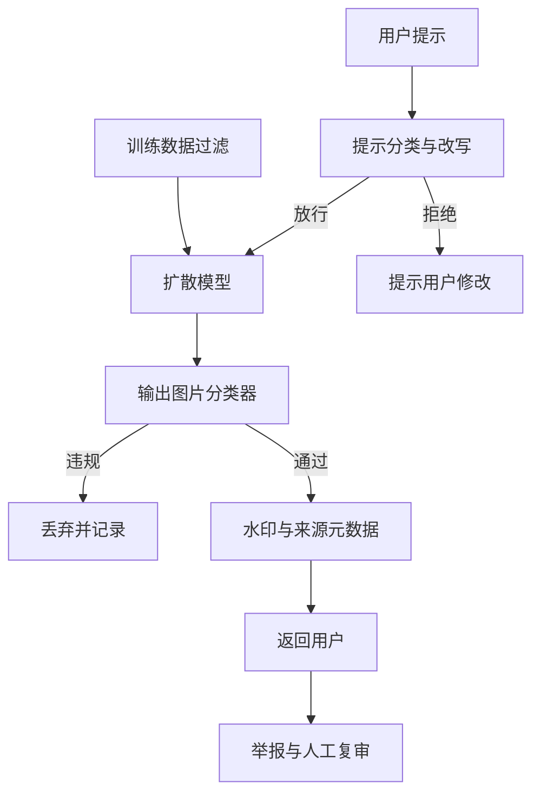

## Q
**深挖 · 安全、来源标识与质量评估**｜文生图服务

面试官：「文生图服务怎样防止生成违规图片、冒用真人形象？生成的图怎么标明是 AI 做的？上线前用什么指标评估新模型？」

## A
**一句话。** 安全分四层：训练数据过滤、提示检查（分类器加改写）、输出图片分类、事后举报与复审；来源标识用不可见水印加可验证的元数据；质量评估用 FID 看整体分布、CLIPScore 看图文相符、人工成对偏好做最终决定，外加一套安全评测集量违规率和误拦率。

**安全的步骤。**
1. **训练数据：** 去掉违规图片和带个人信息的图片，降低模型"会画"的能力。
2. **提示检查：** 分类器识别违规意图；名人姓名、受保护的角色名按策略拒绝或改写；用大语言模型把含糊的提示改写得更明确，同时去掉危险部分。
3. **输出分类：** 每张图过成人内容、暴力等分类器，按类别设阈值；4 张里有 1 张违规就只返回其余 3 张。
4. **复审闭环：** 举报和高分拦截进入人工复审，确认的样本补进分类器训练集和评测集。

**来源标识。**
- **不可见水印：** 在像素里嵌入人眼看不到、可被检测器读出的信号；对裁剪、压缩有一定鲁棒性，但能被刻意去除。
- **元数据：** 在文件里写入签名过的来源信息（例如 C2PA 内容凭证），可验证但会在截图或重新保存时丢失。两者一起用。

**质量评估。**
- **FID：** 用一个图像识别网络提取生成图集和真实图集的特征，比较两组特征的均值和协方差，越低越接近真实分布。只看整体，不看是否贴合描述，需要上万张图才稳定。
- **CLIPScore：** 图文向量相似度，量是否贴合描述；对"三只猫在左边"这类数量和位置不敏感。
- **组合能力评测集：** 专门写含数量、颜色、位置关系的提示，用检测模型或人工判断对不对。
- **人工成对偏好：** 同一提示新旧模型各出一张，盲选更好的，最接近用户感受。

**故障与处理。**
- **背出训练图片：** 少数重复出现很多次的训练图可能被几乎原样生成。处理：训练集去重，用相似度检索检查输出与训练集的近似重复。
- **误拦过多：** "一个拿着刀切菜的厨师"被拦。处理：安全评测集里放良性但敏感的提示，量误拦率。
- **对抗提示：** 用拼写变体、其他语言绕过提示检查。处理：输出分类兜底，持续收集绕过样本。

**为什么这样，不那样。** 只查提示挡不住拼写变体；只查输出会浪费已花掉的 GPU 时间；两端都查，提示检查拦住大部分，输出检查兜底。
