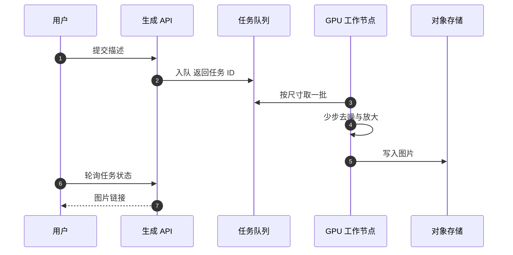

## Q
**深挖 · 生成速度与 GPU 成本**｜文生图服务

面试官：「一次生成要几十步去噪，峰值几百次每秒。怎么在不明显降低质量的前提下，把延迟和 GPU 成本降下来？」

## A
**一句话。** 成本 ≈ 请求数 × 每张图的步数 × 每步耗时，所以三管齐下：减步数（更好的采样器，或蒸馏成 1–8 步的模型）、减每步耗时（低精度计算、较小分辨率生成后再放大）、提高利用率（按尺寸凑批、按队列长度扩缩容、免费用户走快速模型）。每一项都要用同一套评测集确认质量没掉。

**手段。**
1. **更好的采样器：** 训练时 1,000 级噪声，生成时用确定性或高阶采样器只走 20–30 步，质量接近。
2. **蒸馏：** 让一个学生模型学"老师走很多步的结果"，用 1–8 步直接生成；速度提升 5–20 倍，代价是多样性和细节略降，适合预览和免费档。
3. **先小后大：** 先在较低分辨率生成，再用超分辨率模型（把小图放大并补细节的模型）放大到 1024×1024；放大比直接在高分辨率去噪便宜。
4. **低精度：** 用 16 位或 8 位数字代替 32 位存权重和计算，每步更快、占显存更少；8 位要验证没有画质退化。
5. **凑批：** 相同尺寸、相同步数的请求一起算，GPU 利用率高；为了凑批最多等几十毫秒。
6. **分档：** 预览先用快速模型出低清图，用户选中再精修；付费用户高优先级。
7. **缓存：** 只对完全相同的描述、参数和随机种子才能复用；实际命中率低，主要用于热门模板。

**故障与处理。**
- **队列积压：** 处理：按队列等待时间扩容；扩容需要加载几 GB 权重，冷启动几十秒，所以保留预热副本；过载时降级到快速模型或拒绝免费请求。
- **工作节点崩溃：** 任务有租约，超时未完成就重新入队；同一任务 ID 重复生成时只保留第一份结果。
- **蒸馏模型质量下降没被发现：** 处理：上线前和原模型做成对人工比较，并量 FID 与 CLIPScore。

**为什么这样，不那样。**
- **异步而不是同步长连接：** 生成要几秒到十几秒，排队时间不可控；任务 ID 加轮询或推送更稳，断线也不丢结果。
- **不只靠加 GPU：** 步数减半等于 GPU 数量减半，算法优化的杠杆远大于加机器。

**数字（假设）。** 一次请求 4 张图、30 步、每步约 60 ms 时约 1.8 秒；蒸馏成 4 步约 0.25 秒，同样的 GPU 能多服务约 7 倍请求。
