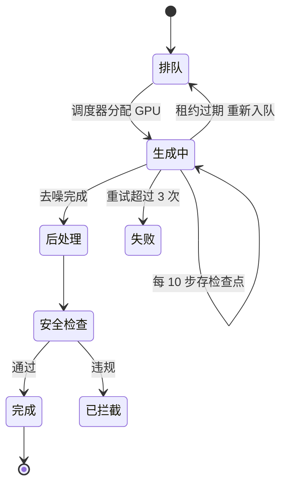

## Q
**深挖 · 异步任务、排队与失败恢复**｜文生视频服务

面试官：「一个视频要多块 GPU 算几分钟。从用户提交到拿到视频，任务怎么排队、怎么分优先级、GPU 节点中途挂了怎么办、怎么防止重复扣费？」

## A
**一句话。** 每个生成请求是一个持久化的任务，带幂等键和状态机；调度器按优先级和配额把任务分给空闲的 GPU 组；工作节点持租约执行，每隔若干步把中间潜向量存为检查点，节点失败时租约到期、任务从最近检查点续跑；完成后写对象存储并推送通知，扣费只在成功时提交一次。

**步骤。**
1. **提交：** `POST /videos` 带客户端生成的幂等键；服务先检查配额、预扣额度，写任务行（状态"排队"），返回任务 ID。同一幂等键重复提交返回同一个任务。
2. **调度：** 按优先级分多个队列（付费、免费、批量）；同一档内按提交时间；每个用户有并发上限，防止一个人占满集群。
3. **执行：** 调度器把任务分给一组 GPU（一个视频可能要 4–8 块），写入租约到期时间；工作节点定期续约。
4. **检查点：** 每 10 步把当前潜向量、随机数状态和步数写到对象存储；潜向量只有几 MB 到几十 MB，写入很便宜。
5. **恢复：** 节点崩溃后不再续约；租约过期，任务回到队列，新节点从最近检查点继续，而不是从头再来。
6. **后处理：** 解码、插帧、超分辨率、逐帧安全检查、加水印、转码。
7. **交付：** 写对象存储，状态改为"完成"，推送通知（网页推送、邮件或回调）；正式扣费，预扣转实扣；失败或拦截时退回预扣额度。

**故障与处理。**
- **重复执行：** 旧节点只是网络卡顿，租约过期后新旧两个节点都在算。处理：写结果时带租约版本号（fencing token），旧版本的写入被拒绝。
- **队列过长：** 处理：给出预计等待时间；免费档限流；高峰时默认只生成预览。
- **安全拦截后的成本：** 已花的 GPU 时间无法收回，所以提示检查要在排队前做。

**为什么这样，不那样。**
- **检查点而不是失败重跑：** 一个任务占 8 块 GPU 几分钟，从头重跑浪费明显；检查点只多几次小写入。
- **预扣而不是事后扣：** 防止用户在额度不足时提交大量任务；失败自动退回，账务清楚。

**数字（假设）。** 8 块 GPU × 1 分钟 = 8 GPU 分钟/视频；若平均失败率 2%、平均在一半时失败，无检查点要多花约 1% 的总算力，在约 2,800 块 GPU 的规模下约等于 28 块 GPU 白算，还要加上从头重排队的延迟。
