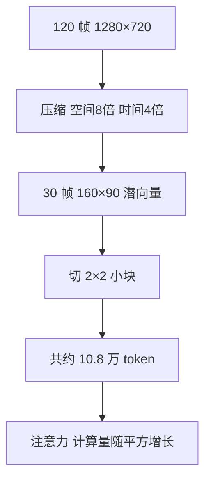

## Q
**深挖 · 视频生成的计算量估算**｜文生视频服务

面试官：「一段 5 秒、720p、24 帧每秒的视频，在扩散 Transformer 里大概是多少个 token？为什么它比生成一张 1024×1024 的图片贵几百倍？这对系统设计意味着什么？」

## A
**一句话。** 视频先被自编码器在空间上压缩 8 倍、时间上压缩 4 倍，再切成 2×2 的小块当 token，5 秒视频约 10.8 万个 token，而一张 1024×1024 图片约 4,000 个；注意力（每个 token 都要和其他所有 token 计算一次相关度）的计算量随 token 数的平方增长，所以每一步去噪里注意力部分贵约 700 倍，其余随 token 数线性增长的部分贵约 26 倍。这决定了必须异步、必须多 GPU 并行、必须先出低清预览。

**手算（假设压缩倍数是常见值）。**
1. **帧数：** 5 秒 × 24 帧/秒 = 120 帧。
2. **压缩：** 空间各除以 8：1280 ÷ 8 = 160，720 ÷ 8 = 90；时间除以 4：120 ÷ 4 = 30 个潜帧。
3. **切块：** 每 2×2 个潜像素一个 token：80 × 45 = 3,600 个/帧；× 30 帧 = 108,000 个 token。
4. **对比图片：** 1024×1024 → 128×128 潜空间 → 64 × 64 = 4,096 个 token。
5. **比例：** token 数约 26 倍，随 token 数线性增长的计算（每个 token 过前馈层）约 26 倍；注意力两两计算，约 26² ≈ 700 倍。视频从 5 秒拉到 10 秒，token 翻倍，注意力约 4 倍。

**对系统的影响。**
- **多 GPU 算一个视频：** 10 万级 token 的注意力中间结果放不进一块 GPU 的显存，要把序列切开分给多块 GPU（序列并行），GPU 之间高速互连成为瓶颈。
- **只能异步：** 一个视频几十秒到几分钟，同步 HTTP 请求会超时，必须是任务 ID 加通知。
- **级联省算力：** 先在低分辨率、低帧率下生成（token 少一个数量级），用户确认后再插帧、超分辨率。
- **按秒计费与配额：** 成本和"秒数 × 分辨率"近似成正比，定价和配额按这个单位。
- **容量规划：** 用"每视频 GPU 分钟数 × 每天视频数"估 GPU 数，再留峰值余量。

**降低计算量的办法与代价。**
- **更强的时间压缩：** token 更少，但快速运动容易模糊。
- **分解注意力：** 先在每帧内部做注意力，再在同一位置的不同帧之间做，计算量从"全体平方"降到"每帧平方 + 帧数平方"；代价是跨帧跨位置的关系（物体移动）学得更弱。
- **减步数和蒸馏：** 与图片相同，步数减半成本减半，要用评测确认画质和运动没退化。
