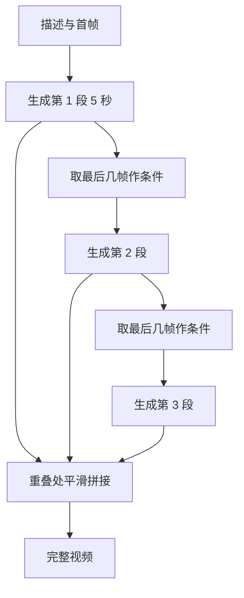

## Q
**深挖 · 时间一致性与更长的视频**｜文生视频服务

面试官：「为什么不能逐帧用文生图模型生成再拼成视频？怎么保证人物和物体在几秒内不变形、不闪烁？要生成 30 秒以上的视频怎么办？」

## A
**一句话。** 逐帧独立生成时，每帧的随机噪声不同，人物的脸、衣服、背景每帧都会变，看起来剧烈闪烁；解决办法是把整段视频作为一个整体去噪，让每个 token 能看到其他帧（时空注意力）。超过模型单次长度的视频用分段生成：每段以上一段的最后几帧为条件续写，再在重叠处平滑衔接；或先生成关键帧，再在关键帧之间插帧。

**一致性的手段。**
1. **联合去噪：** 所有帧在同一个潜张量里一起去噪，模型在训练中学到"相邻帧应该几乎一样，只是有运动"。
2. **时空注意力：** 每个 token 能关注其他帧同一物体的位置，所以同一个人的脸在各帧保持一致。
3. **视频自编码器：** 在时间维度上一起压缩和还原，解码时帧间自然平滑；逐帧解码会引入闪烁。
4. **首帧条件：** 以一张图为首帧，后续帧都对齐它，人物和风格更稳定。

**更长视频的方法。**
- **分段续写：** 每段以上一段最后几帧为条件；简单，但误差会累积，几段后人物可能逐渐变样。
- **关键帧 + 插帧：** 先在低帧率下生成整段的关键帧（全局一致），再在相邻关键帧之间插出中间帧；全局结构好，但快速运动的插帧容易模糊。
- **引用固定的人物外观：** 把主角的参考图作为每段的条件，缓解漂移。

**故障与处理。**
- **漂移：** 第 4 段的人和第 1 段不像了。处理：每段都带第一段的参考帧或人物参考图，而不只是上一段的尾帧。
- **接缝：** 段与段之间亮度、位置跳变。处理：段间重叠几帧，在重叠区按权重混合。
- **物理不合理：** 物体穿模、手指数目变化。处理：评估集专门放运动和物体交互的提示，人工打分；短期内无法完全消除，产品上限制时长和场景。

**评估一致性。**
- **帧间相似度：** 相邻帧特征的相似度，过低是闪烁，过高可能是几乎不动。
- **主体一致性：** 用人脸或物体特征比较首帧和末帧的同一主体。
- **人工评分：** 运动自然度和主体稳定性单独打分。

**为什么这样，不那样。** 逐帧生成最便宜，但没有跨帧信息，一致性无法事后修补；整体去噪计算量大得多，却是连贯画面的前提。
