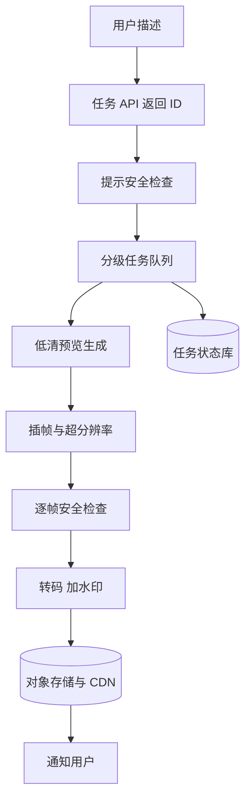

## Q
**全景**｜完整答案 · 文生视频服务

面试官：「设计一个文生视频服务：用户输入描述，得到一段 5–10 秒、720p 的视频。画面要连贯，不能闪烁变形。按 ML 系统设计的七步讲，重点说明计算量和交付方式。」

## A
**一句话。** 把扩散模型（从噪声出发、分几十步逐步去噪生成内容的模型）从图片扩展到"时空"：视频先被压缩成时空潜向量，切成时空小块当 token，由 Transformer 在文字引导下一起去噪，保证帧与帧连贯；单个视频要占用多块 GPU 几十秒到几分钟，所以服务必须是异步任务：排队、分级、可恢复，完成后通知。

**① 需求。**
- **功能：** 文字生成视频；可选时长、比例；先出低清预览，再出高清；可以用一张图作为首帧。
- **非功能：** 5 秒 720p 视频几分钟内完成；画面无闪烁、物体不突变；违规内容拦截；成本可控（按秒计费或配额）。
- **规模（假设）：** 每天 50 万个视频，平均约 6 个/秒；假设每个视频占 8 块 GPU 1 分钟，平均就要约 2,800 块 GPU 持续工作。计算量是整个设计的主线。

**② 定义成 ML 任务。** 条件生成：给定文字（可选首帧图片），从"与描述相符的视频"分布中采样。训练目标同图片扩散：预测加进视频潜向量里的噪声。

**③ 数据。** 数千万到上亿段视频—文字对：按镜头切换点切成单镜头片段；过滤静止画面、字幕水印过多、晃动严重的片段；用视频描述模型给每段重写详细说明；图文对数据混入训练，补足画面多样性。

**④ 模型。** 视频自编码器（在空间和时间上同时压缩）+ 文本编码器 + 时空扩散 Transformer；常用级联：先生成低分辨率、低帧率，再做时间插帧和空间超分辨率。

**⑤ 评估。** 离线：FVD（生成视频集合与真实视频集合的特征分布距离）、逐帧的图文相符分、帧间一致性分；人工成对偏好看画质、运动是否自然、是否贴合描述。在线：完成率、下载率、重新生成率、举报率。

**⑥ 部署。** 任务队列 + 状态机；多 GPU 并行算一个视频；中间结果存检查点，节点失败后从最近一步继续；成品写对象存储，经 CDN 分发。

**⑦ 监控。** 排队时长、每视频 GPU 分钟数、失败重试率、安全拦截率、预览到高清的转化率。

**必讲深挖。**
- **计算量估算：** 视频变成多少 token，为什么比图片贵几百倍。
- **时间一致性与长视频：** 联合时空去噪、分段生成与衔接。
- **异步交付：** 任务状态机、优先级、配额、失败恢复。

**级别。** 中级讲清流水线和异步交付；高级能算出 token 数并讲清一致性方法；Staff 还讲 GPU 容量规划、计费与配额、预览优先的产品策略。
