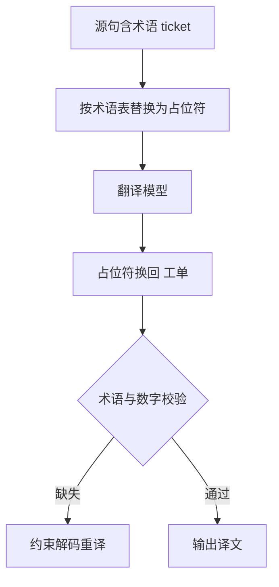

## Q
**深挖 · 翻译质量评估与术语约束**｜机器翻译服务

面试官：「BLEU 是怎么算的，它有什么盲点？除了 BLEU 还用什么评估？企业客户要求 "pod" 必须保持英文、"ticket" 必须译成"工单"，怎么保证？」

## A
**一句话。** BLEU 统计机器译文和参考译文之间 1–4 个词的片段重合率，再惩罚过短的译文，适合比较同一测试集上的两个版本，但不懂同义和语序；所以再加 COMET 这类用人工评分训练出来的模型指标，并以专业译员的错误标注为最终标准。术语用"占位符替换 + 生成后校验"保证，大语言模型方案则把术语表直接写进提示。

**BLEU 的算法（小例子）。**
- **参考：** "猫 坐 在 垫子 上"；**译文：** "猫 坐 在 地毯 上"。
- **1 词片段：** 5 个里 4 个出现在参考中，4/5。**2 词片段：** "猫坐""坐在""在地毯""地毯上"中有 2 个命中，2/4。3 词、4 词片段同理。
- **合成：** 四个精确率取几何平均，再乘长度惩罚（译文比参考短时扣分，防止只输出几个有把握的词）。结果常写成 0–100。

**BLEU 的盲点。**
- **同义词零分：** "地毯"和"垫子"意思接近也不得分。
- **只有一个参考：** 合理的另一种译法被扣分。
- **句子级不稳定：** 只在整套测试集上比较才有意义，单句分数参考价值低。
- **分词敏感：** 中文、日文要先切词，切法不同分数不同，所以要用统一的工具和设置报告。

**其他评估。**
- **chrF：** 按字符片段算重合，对形态变化多的语言更公平。
- **COMET：** 把源句、译文、参考一起输入一个训练过的模型，输出接近人工评分的分数；和人工判断的一致性明显好于 BLEU。
- **人工错误标注：** 译员标出每处错误的类型（误译、漏译、术语、语法）和严重度，加权成分数，是发布决策的最终依据。
- **质量估计：** 没有参考译文时预测质量，用于线上监控和挑出需要人工后编辑的句子。

**术语约束的步骤。**
1. 源句中匹配术语表，把 "ticket" 替换成占位符（如 `__T1__`），模型训练时见过占位符要原样保留。
2. 翻译后把占位符换成"工单"；"pod" 这类保留词直接原样换回。
3. 校验每个术语都出现在译文中；缺失时用约束解码（生成时强制包含指定词）重译。

**为什么这样，不那样。**
- **不只看 BLEU：** BLEU 涨 1 分不一定人能感觉出来，换了模型结构时 BLEU 甚至会和人工判断反向。
- **占位符对比直接替换译文里的词：** 事后替换会弄错语法（词性、格、量词）；占位符让模型在翻译时就为它留好位置。
